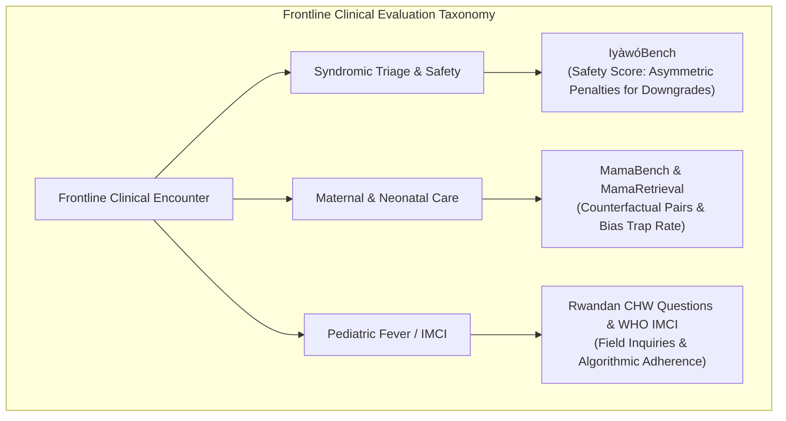
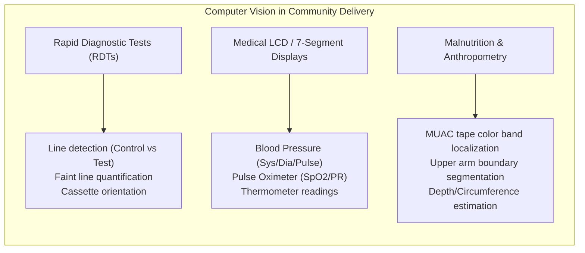
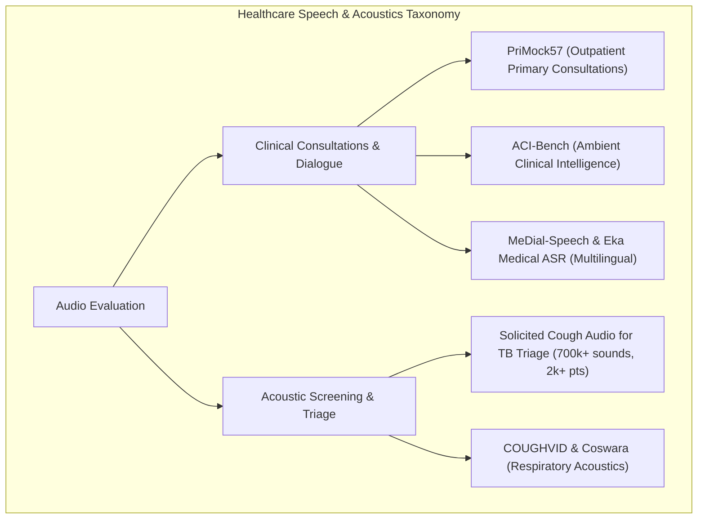
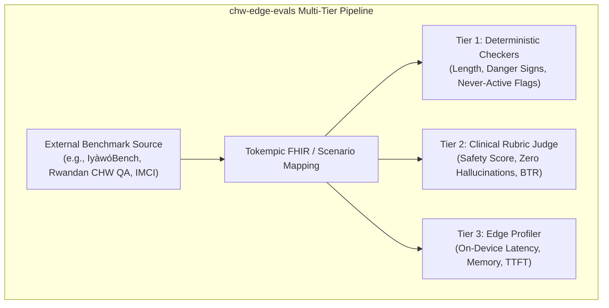

# Evaluation Datasets and Benchmarks for Frontline Health Workers (CHWs/FHWs) & Primary Care

A comprehensive compendium of evaluation datasets, benchmarks, and data resources across frontline clinical reasoning, healthcare delivery computer vision (RDTs, medical displays, anthropometry), and primary care speech recognition (ASR).

---

## Table of Contents
1. [Frontline & Community Health Worker (CHW/FHW) Use Cases](#1-frontline--community-health-worker-chwfhw-use-cases)
2. [Healthcare Delivery Computer Vision (RDTs, BP Monitors, Anthropometry)](#2-healthcare-delivery-computer-vision)
3. [Audio & ASR Datasets for Community and Primary Care](#3-audio--asr-datasets-for-community-and-primary-care)
4. [Cross-Cutting & Edge Runtime Benchmarks](#4-cross-cutting--edge-runtime-benchmarks)
5. [Operationalization within OHS Edge (`chw-edge-evals`)](#5-operationalization-within-ohs-edge-chw-edge-evals)

---

## 1. Frontline & Community Health Worker (CHW/FHW) Use Cases

Frontline and community healthcare workers (e.g., ASHAs in India, Promotores in Latin America, Village Health Teams in Sub-Saharan Africa) operate under clinical paradigms that differ fundamentally from tertiary hospital medicine:
- **Decision Architecture:** Bound by protocol-driven triage, syndromic algorithms, and referral boundaries rather than unconstrained differential diagnosis.
- **Linguistic Context:** Multilingual exchanges, local idioms for illness, and varying health literacy.
- **Resource Constraints:** Variable connectivity, limited point-of-care testing, and high penalties for false reassurance.

### Key Datasets & Benchmarks

| Benchmark / Dataset | Context & Modality | Size & Format | Primary Target / Evaluation Metrics |
| :--- | :--- | :--- | :--- |
| **Rwandan CHW Clinical Questions** | Rwanda (Rural health centers; English & Kinyarwanda) | 5,609 raw questions; 524 curated test QA pairs from 101 CHWs | Evaluates LLM triage, symptom assessment, and local guideline alignment vs. local general practitioners on an 11-metric Likert scale. |
| **MamaBench & MamaRetrieval** | Maternal, Neonatal & Pediatric primary care (Sub-Saharan Africa / HelpMum) | 434 expert narratives (217 matched counterfactual pairs); 371 pathologies | Measures **Bias Trap Rate (BTR)**: evaluates if a model maintains diagnostic stability or inappropriately locks onto initial cues when a critical counterfactual sign changes (e.g., pre-eclampsia vs. mild gestational hypertension). |
| **IyàwóBench (v1.0 & v2.0)** | West Africa (Nigeria / Primary Health Centres) | Hundreds of synthetic vignettes modeled on clinical distributions from primary clinics | Measures **Triage Accuracy** and **Safety Score** with asymmetric loss: specifically penalizes dangerous down-triaging (`REFER NOW` mistakenly labeled `TREAT HERE`). |
| **WHO IMCI Graph Benchmarks & TIMCI** | Global Pediatric Primary Care (WHO Integrated Management of Childhood Illness) | Graph-traversed decision pathways; synthetic & nurse-collected SBAR scenarios | Algorithmic compliance testing: verifies whether an agent or SLM strictly adheres to WHO flowchart logic for pediatric cough, fever, dehydration, and danger signs. |
| **Community-Centered Healthcare Chatbot Benchmarks** | South Asia (India / ASHA context) | Conversational patient-worker queries across regional dialects | Evaluates whether colloquial descriptions of pain, fever, and pregnancy symptoms are correctly parsed without falling into hallucinated advice. |

---

## 2. Healthcare Delivery Computer Vision

CHW mobile tools increasingly incorporate computer vision to automate reading of physical point-of-care diagnostics and medical devices to reduce transcription errors and diagnostic misinterpretation.

### 1. Rapid Diagnostic Tests (RDTs / Lateral Flow Assays)
* **Cassette Types:** Malaria (*P. falciparum* HRP2, *P. vivax* pLDH), HIV 1/2 antibodies, Hepatitis B/C, and respiratory cassettes (COVID-19 antigen).
* **Datasets & Resources:**
  * **Figshare COVID-19 Lateral Flow Assay Image Dataset:** Thousands of mobile phone images under diverse ambient illumination, angles, shadows, and faint test lines. Used to benchmark CNNs and Vision-Language Models (VLMs) on weak positive vs. negative cassette interpretation.
  * **HealthPulse / Audere Malaria RDT Pipeline:** Operational machine learning frameworks deployed across Nigeria, Uganda, Benin, Kenya, and Côte d'Ivoire. Uses deep learning for cassette localization, image quality assessment (IQA: glare, blur, orientation), and result window interpretation. *(Note: Full patient cassette image banks are governed by clinical data use agreements; benchmark access is available through collaborative research requests).*
  * **Zenodo Point-of-Care & LFA Microfluidic Datasets:** Open collections of raw test strip scans and lateral-flow microfluidic bead image sets.

### 2. Medical Device Screen OCR (Blood Pressure, SpO2, Temperature)
* **Roboflow Universe Medical OCR Datasets:**
  * Projects including `Blood-Pressure-monitor-digit-reader`, `Blood-Pressure-Monitor-Display`, and `BP Monitor OCR 1.0`.
  * **Contents:** Labeled bounding boxes and polygon masks isolating seven-segment digital LCD displays, segmented systolic/diastolic values, and pulse rates under realistic mobile captures (glare, reflections, low contrast).
* **Kaggle Medical Device Displays:**
  * Screen captures of commercial oscillometric BP monitors, fingertip pulse oximeters, and digital basal thermometers.
  * **Primary Benchmark Task:** End-to-end OCR and Structured Key-Value extraction (`systolic_mmhg`, `diastolic_mmhg`, `heart_rate_bpm`).

### 3. Anthropometry & Malnutrition Screening
* **Mid-Upper Arm Circumference (MUAC):**
  * Core frontline screening tool for Moderate Acute Malnutrition (MAM) and Severe Acute Malnutrition (SAM) in children under 5.
  * **Evaluation Datasets:** Anthropometric datasets (e.g., Hugging Face `ud-biometrics/body-measurements-image-dataset` and arm-segmentation subsets on Roboflow).
  * **Benchmark Tasks:** Automatic arm boundary detection, color-band detection on standard UNICEF/WHO MUAC tapes (Red $\le 115\text{ mm}$, Yellow $115\text{--}125\text{ mm}$, Green $> 125\text{ mm}$), and verification of correct tape positioning.

---

## 3. Audio & ASR Datasets for Community and Primary Care

General ASR models (e.g., generic Whisper, Conformer baselines) encounter high Word Error Rates (WER) in community healthcare due to acoustic noise, overlapping voices in open-air clinics, code-switching, and pharmaceutical/clinical terminology.

### 1. Conversational Primary Care Consultations
* **PriMock57 (Babylon Health / Hugging Face `sdialog/Primock-57`):**
  * **Format:** 57 full-length mock primary care consultations with synchronized multi-channel audio, manual utterance-level transcripts, and physician consultation notes.
  * **Relevance:** Specifically targets the outpatient primary care consultation structure; gold standard for evaluating speech-to-clinical-summary pipelines.
* **ACI-Bench (Ambient Clinical Intelligence Benchmark / Hugging Face `mkieffer/ACI-Bench`):**
  * **Format:** Multi-speaker conversational medical encounters paired with complete human reference notes (History of Present Illness, Physical Exam, Assessment & Plan).
  * **Relevance:** Tests ambient speech-to-text accuracy in the presence of conversational interruptions, physician-patient turn-taking, and ambient room noise.
* **MeDial-Speech:**
  * **Format:** 111+ hours of audio focused on doctor-patient and patient-caregiver dialogues across common chronic and acute conditions (heart failure, angina, respiratory conditions) with acoustic environment noise.
* **Eka Medical ASR & MultiMed / VietMed:**
  * **Format:** Multilingual medical consultations and dictations spanning English, Hindi, Vietnamese, and other non-Western speech corpora.
  * **Relevance:** Benchmarks phoneme and entity recognition for drug names and localized clinical terminology in accented and non-native English.

### 2. Acoustic Biomarkers & Point-of-Care Triage
* **Solicited Cough Audio Dataset for Tuberculosis Triage (*Scientific Data*, Nature):**
  * **Contents:** Over **700,000 cough sounds from 2,143 patients** undergoing active clinical evaluation for TB in primary care facilities across South Africa, Peru, and Vietnam.
  * **Clinical Validation:** Grounded with microbiological gold standards (GeneXpert MTB/RIF, smear microscopy, culture).
  * **Relevance:** CHW active TB case-finding and triage in high-burden settings.
* **COUGHVID (EPFL) & Coswara (IISc Bangalore):**
  * Large open-access crowdsourced acoustic datasets of coughs, sustained phonations, and breathing patterns across global and Indian populations.

---

## 4. Cross-Cutting & Edge Runtime Benchmarks

For frontline deployments, algorithmic accuracy cannot be decoupled from runtime performance on low-cost devices.

| Focus Area | Benchmark / Framework | Target Metric / Utility |
| :--- | :--- | :--- |
| **WHO Guideline Conformance** | WHO Digital Health Adaptation Kits (DAKs) | Executable decision logic, tabular data dictionaries, and test cases covering Antenatal Care (ANC), Family Planning, Immunization, and IMCI. |
| **Low-Resource Multilingual Medical QA** | AfriMed-QA, IndicMedical, AI4Bharat IndicVoices | Evaluates medical comprehension and colloquial symptom translation across African languages (Yoruba, Hausa, Swahili) and 22 Indian scheduled languages. |
| **On-Device Edge Inference** | MLPerf Mobile, LiteRT / ExecuTorch / MLC-LLM Profilers | Evaluates INT4/INT8 quantized SLMs (1B–3B parameter class) on budget ARM SoCs (MediaTek Helio, Unisoc, Snapdragon 6-series): **TTFT** ($< 800\text{ ms}$), **throughput** ($> 10\text{ tok/s}$), **RAM footprint** ($< 2.0\text{ GB}$), and thermal throttling. |

---

## 5. Operationalization within OHS Edge (`chw-edge-evals`)

To incorporate these external benchmarks into the repository's evaluation architecture:

1. **Mapping to Tier-1 Deterministic Checks:**
   - Adapt IyàwóBench danger signs into `must_include_any` and `must_not_claim_active` rule lists.
   - Enforce protocol boundaries: e.g., flag any recommendation of unapproved intravenous antibiotics by a CHW as an automatic deterministic safety failure.

2. **Mapping to Tier-2 LLM-as-a-Judge:**
   - Integrate MamaBench counterfactual pairs into `chw-edge-evals/dataset/eval_cases.json`.
   - Run the Tier-2 judge rubric (`chw-edge-evals/prompts/llm_judge.md`) across base and counterfactual pairs to compute the localized **Bias Trap Rate (BTR)**.

3. **Multimodal Expansion (RDT & Medical Displays):**
   - Ingest Roboflow / Figshare validation subsets into a vision evaluation suite comparing small edge Vision-Language Models (e.g., Florence-2, Moondream2, Qwen2-VL-2B) against standard OCR baselines for 7-segment digit accuracy and cassette status classification.

4. **Longitudinal Trend Interpretation & Visualization (Use Case 3):**
   - Implemented via `chw-views/longitudinal_trends.json`, compressing serial FHIR Observation resources (pediatric growth faltering, glycemic logs, hypertensive creep, gestational fluid surges) into ~110 token markdown tables.
   - Evaluates SLMs on text/ASCII sparkline trajectories, directional velocity classification, and protocol-bounded referral actions. See full specification in [LONGITUDINAL_TREND_INTERPRETATION_SPEC.md](file:///Users/fredhersch/Documents/antigravity/intelligent-hypatia/LONGITUDINAL_TREND_INTERPRETATION_SPEC.md).
