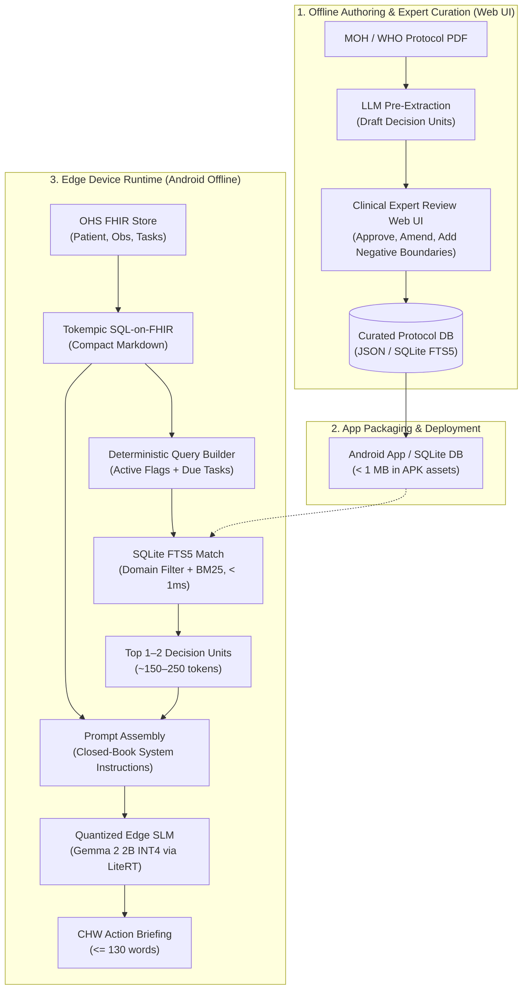

# Clinical Mini-RAG Pipeline Specification & Protocol Curation Guide
**Project:** OHS Edge Offline LLM Evaluation & Deployment Framework (`chw-edge-evals`)  
**Target:** Budget Android Devices (LiteRT / MediaPipe / SQLite FTS5)  
**Clinical Scope:** Community Health Promoter (CHP) / CHW Protocols (Kenya MOH eCHIS / WHO)

---

## 1. End-to-End Edge Mini-RAG Architecture



---

## 2. Clinical Decision Unit (CDU) Metadata Schema

To make retrieval and generation **hallucination-proof**, every protocol unit is tagged with explicit semantic metadata and negative guardrails.

### Schema Definition (`protocol_units.json`)

```json
{
  "id": "KENYA-MOH-MNH-02",
  "domain": "02_mnh",
  "topic": "Hypertension & Suspected Pre-Eclampsia",
  "source_reference": {
    "organization": "Kenya Ministry of Health",
    "manual": "CHP Technical Training Manual - Module 2: Maternal and Newborn Health",
    "section": "Managing Danger Signs in Pregnancy",
    "page_or_code": "MoH 514 / eCHIS ANC-04"
  },
  "target_cohort": {
    "gender": "female",
    "min_gestation_weeks": 20,
    "patient_status": "pregnant"
  },
  "trigger_index": {
    "primary_conditions": ["hypertension", "pregnancy-induced hypertension", "pre-eclampsia", "high bp"],
    "symptoms": ["headache", "blurred vision", "epigastric pain", "face swelling"],
    "observations": ["bp >= 140/90", "proteinuria >= 1+"]
  },
  "clinical_payload": {
    "entry_criteria": "Gestational age >= 20 weeks with Systolic BP >= 140 mmHg OR Diastolic BP >= 90 mmHg.",
    "danger_signs": [
      "Severe frontal headache not relieved by ordinary analgesics",
      "Visual disturbances (blurring, flashes, double vision)",
      "Upper abdominal / epigastric pain or nausea",
      "Swelling of hands/face and sudden weight gain"
    ],
    "mandated_chw_actions": [
      "Initiate immediate emergency referral to nearest Level 4 hospital / CEmoNC facility",
      "Assist household with emergency transport and financial logistics",
      "Reassure mother; position comfortably on her left side during transit"
    ],
    "negative_boundaries": [
      "STRICTLY FORBIDDEN: Do not prescribe or administer oral or injectable antihypertensives at home (no labetalol, nifedipine, or hydralazine)",
      "STRICTLY FORBIDDEN: Do not attempt parenteral magnesium sulfate injection",
      "Prohibit home herbal teas, sedatives, or traditional remedies"
    ]
  },
  "prompt_injection_chunk": "### [PROTOCOL: KENYA-MOH-MNH-02] Pre-Eclampsia\nCRITERIA: GA >= 20w, BP >= 140/90 mmHg or proteinuria >= 1+.\nDANGER SIGNS: Severe frontal headache, vision blur, epigastric pain.\nMANDATED ACTIONS: Refer IMMEDIATELY to Level 4 Hospital. Arrange transport. Keep on left side.\nSTRICTLY FORBIDDEN: Do NOT administer antihypertensives or sedatives. Do NOT give injectable Magnesium Sulfate at community level."
}
```

---

## 3. Should This Be Done by a Domain Expert?

### **Yes, unequivocally.**

#### Why Clinicians Must Sign Off:
1. **The Negative Boundary Problem:** LLMs are notorious for omitting negative constraints (e.g. failing to mention that a digital vaginal exam in late pregnancy bleeding is contraindicated). A clinician or experienced public health midwife immediately spots missing safety boundaries.
2. **Community vs. Facility Scope of Practice:** Guidelines clearly delineate what a CHP is allowed to do vs. what requires a hospital. Only domain experts know the regulatory boundary (e.g. in Kenya, CHPs can administer oral amoxicillin for pediatric fast breathing, but are strictly prohibited from administering injectables).
3. **Legal & Institutional Liability:** Ministries of Health (e.g. Kenya MOH) will not permit AI guidance on community worker tablets without formal clinical protocol sign-off.

#### The Clinician-in-the-Loop Efficiency Model:
**Do not ask clinicians to write JSON or extract protocols manually.** That is tedious and error-prone.
* **Step 1 (AI Drafts):** A script extracts raw PDF sections and parses them into the structured schema.
* **Step 2 (Clinical Expert Validates):** Clinicians use a dedicated web UI to review, correct entries, confirm dosage thresholds, and explicitly verify the `negative_boundaries`.
* **Step 3 (Signed & Locked):** Once approved, the chunk is digitally signed or marked `status: certified` and compiled into the production SQLite database.

---

## 4. Efficient Web Interface Options

### Option A: Built-in Protocol Studio in `visual_eval_studio.py` (Fastest, Zero New Dependencies)
Since the project already runs `visual_eval_studio.py` (a Python HTTP server running on `localhost:8501`), we can add a dedicated **Protocol Curation Tab**:
* **Left Pane:** Displays raw MOH PDF text or Markdown extract.
* **Middle Form:** Interactive fields for:
  - Clinical Criteria
  - Red Flags & Danger Signs
  - Mandated CHW Actions
  - Negative Boundaries / Refusal Traps (highlighted in red)
  - Synonyms / Trigger Keywords
* **Right Pane (Live Preview):** 
  - Live token counter (showing whether the formatted chunk is $\le 160$ tokens).
  - Test query playground (type a patient condition $\rightarrow$ verify that SQLite FTS5 retrieves this exact chunk).
* **Save Action:** Writes directly to `chw-protocols/` and updates the test suite in `eval_cases.json`.

### Option B: Argilla (Best for Distributed / Multi-Clinician Teams)
The repository already contains `argilla_integration.py` and documentation in `OPEN_SOURCE_EVALS_AND_RLHF_GUIDE.md`:
* Spin up Argilla in Docker (`docker run -p 6900:6900 argilla/argilla-server:latest`).
* Create a `FeedbackDataset` with:
  - Text fields for protocol draft.
  - Rating questions: "Are clinical boundaries strictly respected?", "Are all danger signs captured?".
  - Text correction fields for "Approved Mandated Actions" and "Prohibited Actions".
* Multi-user: Allows multiple MOH medical officers or regional supervisors to review and approve chunks independently.
