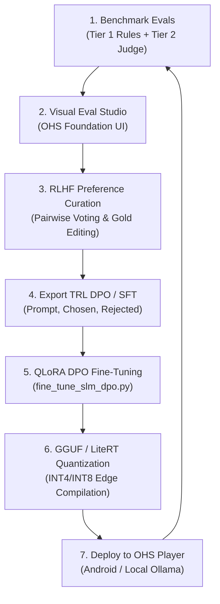
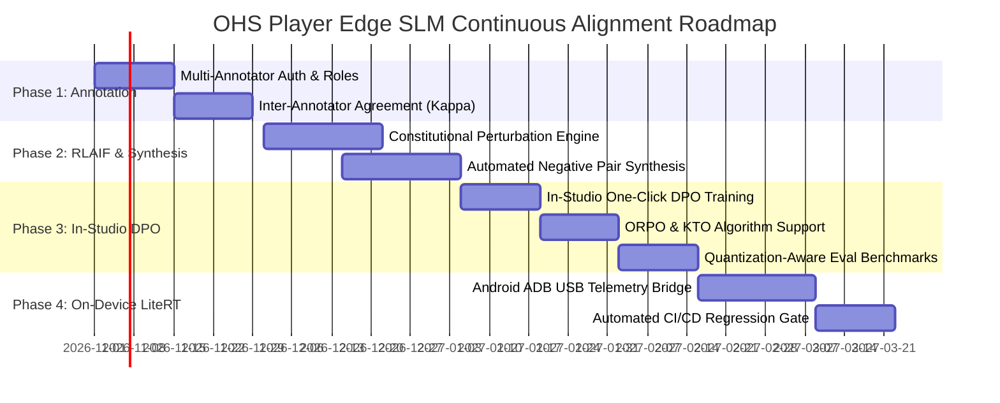

# OHS Player Edge SLM Studio: Product Specification & Continuous Alignment Roadmap

**Document Type:** Technical & Product Specification, Architecture Blueprint, and Engineering Roadmap  
**Target Platform:** Open Health Stack (OHS) Player & Offline Edge SLMs (1B–4B Class)  
**Brand Identity:** Open Health Stack Software Foundation (`ohs.foundation`)  
**Version:** 1.0.0 (As-Built & Roadmap)  
**Date:** October 2026  

---

## 1. Executive Summary & Problem Statement

### 1.1 The Challenge: Offline Edge Clinical Decision Support
In low-connectivity primary healthcare settings, Community Health Workers (CHWs) using budget Android hardware (2GB–4GB RAM) require responsive, hallucination-safe clinical decision support. The primary use cases are:
1. **Pre-Visit Patient & Household Summarization:** Compressing longitudinal FHIR bundles (`Patient`, `Encounter`, `Observation`, `Condition`, `Task`) via Tokempic Markdown into structured 3-bullet briefings ($\le 120$ words).
2. **Mini-RAG CHW Visit Preparation:** Grounding retrieved MOH/WHO clinical guidelines and patient flags into focused counseling points ($\le 130$ words) with strict closed-book refusal boundaries.

### 1.2 The Failure Modes of 1B–4B Edge Models
Quantized Small Language Models (SLMs) such as Gemma 2 2B, Llama 3.2 3B, and Qwen 2.5 3B routinely fail in three critical dimensions:
- **Length & Budget Drift:** Exceeding mobile viewport limits (> 120 words), resulting in text truncation on budget phones.
- **Temporal & Status Traps:** Reporting resolved past medical events (e.g., past malaria) as current active conditions.
- **Safety Boundary Breaches:** Providing out-of-scope clinical advice or prescribing restricted medications (e.g., parenteral antibiotics) instead of instructing an urgent referral.

### 1.3 The Solution: OHS Edge SLM Studio
The **OHS Edge SLM Studio** unifies evaluation, clinical safety grading, human-in-the-loop preference collection (RLHF), and Direct Preference Optimization (DPO) into a single, closed-loop developer and clinical workbench.



---

## 2. System Architecture & Design System

### 2.1 Backend Architecture
- **Zero-Dependency Runtime:** Built purely on Python 3.9+ standard library (`http.server`, `socketserver`, `subprocess`, `threading`, `json`, `urllib`). No external server dependencies (Flask, FastAPI, or Node) required to run the studio.
- **Asynchronous Execution Engine:** Manages background benchmark subprocesses (`run_evals.py`) in non-blocking threads with rolling telemetry buffer capture (up to 2,000 log lines).
- **Resilient Socket Binding:** Implements active port conflict detection with automated failover (scans from port 8501 to 8520) to eliminate `Errno 48 Address already in use` runtime halts.

### 2.2 Frontend Architecture & Design System
The user interface is built strictly adhering to the **Open Health Stack Software Foundation (`ohs.foundation`) Design System**:
- **Design Tokens (OKLCH with Hex Fallbacks):**
  - Canvas: `--bg: #f8faf9`
  - Secondary Canvas: `--bg-2: #f1f5f3`
  - Surface: `--surface: #ffffff`
  - Ink (Primary Text): `--ink: #1c2830`
  - Soft Ink: `--ink-soft: #4e5f6a`
  - Border Lines: `--line: #e1e8eb`
  - AI Commons (Violet): `--ai: #7a4db8` with `--ai-wash: #f3effa`
  - FHIR-Native Core (Blue): `--core: #1f75a8` with `--core-wash: #edf5fb`
  - OHS Toolkit (Teal): `--toolkit: #1e7e8b` with `--toolkit-wash: #ecf6f7`
  - Clinical Pass: `--green: #1ca564` with `--green-wash: #edf8f2`
  - Clinical Fail: `--rose: #dc3e42` with `--rose-wash: #fdf1f1`
- **Typography:**
  - Primary UI Sans: **`Hanken Grotesk`** (weights 300 to 800 via Google Fonts)
  - Code & Telemetry: **`IBM Plex Mono`**
- **Brand Mark:**
  - 4-rounded-square OHS Foundation brand stack (`.logo-mark i`) representing Teal, Core, AI, and Deep Teal.

---

## 3. As-Built Feature Specification (Version 1.0)

| Module | Feature | Implementation Details |
| :--- | :--- | :--- |
| **Benchmark Dashboard** | Multi-Model KPI Cards | Displays Tier-1 Pass Rate %, Summarization Pass Rate %, Mini-RAG Protocol Pass Rate %, Decode Throughput (`tok/s`), and Latency (s). |
| | Multi-Model Leaderboard | Dynamic comparison table sorting models by pass percentage, evaluation checks passed, and judge provider. |
| **Evaluation Visualizer** | Case Explorer | Grid view of all 20 golden clinical archetypes across Antenatal Care (ANC), Child Health (iCCM), Chronic NCDs, and Infectious Diseases. |
| | Clinical Assertion Checklist | Real-time breakdown of Tier-1 deterministic passes and failures with exact missing clinical entity groups or violated trap terms highlighted in red. |
| | Dual-Check View | Side-by-side inspection of Check A (Pre-Visit Summary) and Check B (Mini-RAG Protocol Counseling) with live word counts. |
| **Side-by-Side Comparator** | Model Differential | Compares Candidate Model A vs Candidate Model B completions, generation latency, and pass/fail verdicts on identical patient records. |
| **Live Eval Runner** | Interactive Execution | UI configuration for target SLM (`gemma2:2b-instruct-q4_K_M`, `llama3.2:3b`), Ollama API base, Tier-2 Judge (`gemini-3.8-flash`, `gpt-4o`, `gemma4`), and dry-run mode. |
| | Real-Time Telemetry Stream | Integrated console viewer polling background runner logs at 1.5s intervals with auto-scrolling terminal output. |
| **RLHF & DPO Studio** | Pairwise Preference Review | Side-by-side comparison of candidate completions with single-click selection of **CHOSEN** vs **REJECTED**. |
| | Clinical Critique Tagger | Checkbox tagging for rejection reasons: 1) Resolved Disease as Active, 2) Exceeded Word Limit, 3) Missed Danger Sign / Urgent Referral, 4) Prescribed Medication. |
| | Gold Demonstration Editor | Interactive textarea enabling clinicians to edit or rewrite candidate responses into ideal demonstrations with real-time word counting. |
| | RLAIF Auto-Bootstrapper | Programmatic pairing engine: scans existing runs, assigns high-performing passing models (e.g. Gemma 4 / Gemini) as `chosen` and failing models as `rejected`. |
| | 1-Click Export | Serializes preference records directly to Hugging Face TRL DPO format (`dpo_preference_data.jsonl`) and SFT format (`sft_clinical_data.jsonl`). |
| **Fine-Tuning Engine** | TRL DPO Pipeline Script | `fine_tune_slm_dpo.py` provides 4-bit QLoRA fine-tuning on consumer hardware or Mac MPS, including post-training GGUF conversion instructions. |

---

## 4. Data Schemas & Contracts

### 4.1 Hugging Face TRL DPO Dataset Contract (`dpo_preference_data.jsonl`)
```json
{
  "timestamp": "2026-10-18T11:11:15.000Z",
  "case_id": "case_01_anc_hypertension_red_flag",
  "task": "summarization",
  "model_chosen": "gemma4:latest",
  "model_rejected": "gemma2:2b-instruct-q4_K_M",
  "prompt": "You are an offline assistant helping a Community Health Worker...\n\nPATIENT RECORD MARKDOWN:\n## demographics\nFatima Bello | 1998-04-12 (28y) | female | Koro Village...",
  "chosen": "* **Patient & Context:** Fatima Bello, 28y, from Koro Village. Active conditions include Pregnancy (32 weeks) and Pregnancy-induced hypertension.\n* **Recent Vitals & Findings:** On 2026-10-14, vitals showed elevated Blood Pressure (148/96 mmHg). Observations include 1+ urine protein dipstick and a present frontal headache.\n* **Open Tasks & Due Items:** There is an overdue, urgent referral requested to the District Hospital for pre-eclampsia workup.",
  "rejected": "**Patient & Context:** Fatima Bello, 28y, Koro Village. Active: Pregnancy 32w, PIH.\n**Recent Vitals & Findings:** BP 148/96 mmHg (High), Proteinuria 1+, Frontal headache.\n**Open Tasks & Due Items:** Urgent referral to District Hospital for pre-eclampsia.",
  "critique_tags": ["word_budget_exceeded", "format_headers_missing"],
  "rationale": "Chosen adheres to exact 3-bullet headers and word limits; rejected used bold headers without standard formatting."
}
```

### 4.2 Supervised Fine-Tuning Contract (`sft_clinical_data.jsonl`)
```json
{
  "timestamp": "2026-10-18T11:23:00.000Z",
  "case_id": "case_02_child_iccm_growth_and_overdue_vaccine",
  "task": "visit_prep_rag",
  "instruction": "Provide grounded visit prep counseling under 130 words using simple, actionable bullet points.",
  "input": "[PATIENT RECORD MARKDOWN]\n...\n[RETRIEVED MOH GUIDELINE CHUNKS]\n...",
  "output": "* **Vaccine Safety:** Yellow MUAC (12.6 cm) and mild malnutrition are NOT contraindications to MR2 vaccination. Strongly urge immediate vaccination.\n* **Nutrition Guidance:** Counsel mother on 4-star diet: add groundnut paste, eggs, and greens to daily porridge.\n* **Follow-up:** Schedule weight check in 14 days."
}
```

---

## 5. Continuous Improvement Roadmap: From Evals to SOTA SLMs



### Phase 1: Multi-Clinician Collaboration & Team Annotation (Month 1)
- **Role-Based Review:** Add clinician role profiles (e.g. *CHW Supervisor*, *Medical Officer*, *ML Engineer*).
- **Inter-Annotator Agreement:** Compute Fleiss' Kappa and Cohen's Kappa across multi-clinician ratings to identify ambiguous clinical guidelines.
- **Bi-Directional Argilla Synchronization:** Activate automated sync between the Studio and remote Argilla instances via `argilla_integration.py` for distributed public health NGO teams.

### Phase 2: RLAIF & Scaled Synthetic Preference Generation (Month 2)
- **Automated Perturbation (Negative Pair Synthesis):** Generate adversarial negative pairs by taking gold summaries and programmatically:
  1. Switching resolved past conditions into active conditions.
  2. Artificially inflating word counts to 160 words.
  3. Swapping a danger sign vital sign (e.g. BP 148/96) with a normal reading (BP 120/80) to train the SLM never to hallucinate normal values when danger signs are present.
- **Constitutional AI Rubric:** Use Gemini 3.8 / Gemma 4 as an automated critic to generate multi-dimensional critique rationales without requiring manual text entry.

### Phase 3: In-Studio DPO Training & Algorithm Selection (Month 3)
- **Direct Training Launch from Web UI:** Trigger `fine_tune_slm_dpo.py` directly from Tab 5 of the Web Studio, displaying a live training loss curve ($\mathcal{L}_{\text{DPO}}$) and evaluation validation margin.
- **Support for ORPO (Odds Ratio Preference Optimization):** Add ORPO training mode, which unifies SFT and DPO into a single loss function:
  $$\mathcal{L}_{\text{ORPO}} = \mathcal{L}_{\text{SFT}} + \lambda \mathcal{L}_{\text{OR}}$$
  This eliminates the need for a separate warm-up SFT phase and speeds up SLM alignment by $2\times$.
- **Quantization Degradation Matrix:** Automatically evaluate the aligned model across FP16, INT8, and INT4 (Q4_K_M) quantizations to detect if 4-bit weight pruning re-introduces hallucinated vitals.

### Phase 4: On-Device LiteRT & Android Hardware Bridge (Month 4)
- **Android ADB Device Telemetry:** Connect a physical Android test device via USB/ADB and stream on-device runtime metrics directly into Tab 1:
  - Time-to-First-Token (TTFT) on budget ARM Cortex-A53 / A55 cores.
  - Peak Resident Set Size (RSS Memory RAM footprint) under MediaPipe / LiteRT.
  - Battery temperature and milliampere (mA) drain per summary generation.
- **GitHub Actions Automated Quality Gate:** Block any prompt or model update in CI if the Tier-1 pass rate drops below 95% or if any resolved-condition trap fails.

---

## 6. How to Run & Verify

```bash
# 1. Launch the Visual Evaluation & RLHF Studio
python3 visual_eval_studio.py --port 8501

# 2. Open Web Browser
# Access: http://127.0.0.1:8501 (or auto-allocated port 8502)

# 3. Dry-run DPO Dataset Validation
python3 fine_tune_slm_dpo.py --dataset chw-edge-evals/dataset/dpo_preference_data.jsonl --dry-run

# 4. Run Live DPO Training
python3 fine_tune_slm_dpo.py \
  --dataset chw-edge-evals/dataset/dpo_preference_data.jsonl \
  --model-id google/gemma-2-2b-it \
  --output-dir ./dpo_trained_adapter
```
