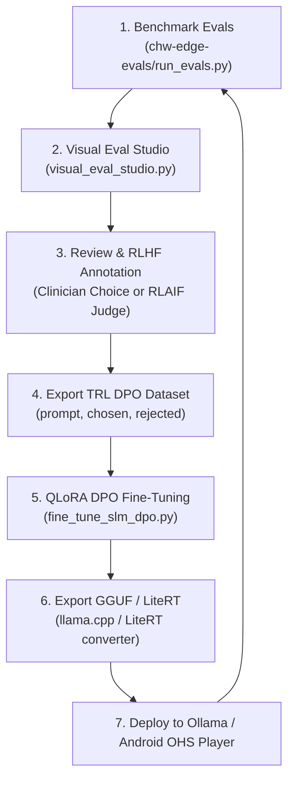

# Open Source LLM Evaluation & RLHF Framework Guide for Edge SLMs

This guide evaluates open-source frameworks for running visual evaluations and driving **Reinforcement Learning from Human Feedback (RLHF)** / **Direct Preference Optimization (DPO)** for Small Language Models (1B–4B parameter class, e.g., Gemma 2 2B, Llama 3.2 3B, Qwen 2.5 3B) deployed in offline clinical settings like **Open Health Stack (OHS) Player**.

---

## 1. Executive Summary & Framework Landscape

Evaluating and aligning 1B–4B edge SLMs presents unique constraints:
- **Strict Formatting & Word Budgets:** Mobile UI constraints require hard token bounds ($\le 120–130$ words) and exact 3-bullet structures.
- **High Clinical Risk / Zero Hallucination:** Medical danger signs (e.g., pre-eclampsia, severe dehydration) must never be dropped; resolved illnesses (e.g., past malaria) must never be reported as active.
- **Compute Efficiency:** Alignment must be feasible on consumer GPUs or Apple Silicon, favoring **Direct Preference Optimization (DPO)** or **Odds Ratio Preference Optimization (ORPO)** over memory-heavy PPO.

### Framework Evaluation Matrix

| Framework | Primary Focus | Visual UI Quality | RLHF / DPO Readiness | Offline / Local SLM Support | Best Use Case |
| :--- | :--- | :--- | :--- | :--- | :--- |
| **Argilla** | Human & AI Feedback Curation | **Exceptional** (Multi-annotator web UI) | **Native** (Direct push to Hugging Face TRL `DPOTrainer`) | Excellent (Docker / Python) | Team-based clinical annotation, preference rating, and DPO dataset curation |
| **Promptfoo** | Prompt & Assertion Evals | **Excellent** (`npx promptfoo view` matrix) | Moderate (Exports CSV/JSON; no native DPO pairing) | Native (Ollama, local endpoints) | Rapid local iteration on prompt templates and deterministic assertions |
| **DeepEval (Confident AI)** | LLM Unit Testing (Pytest) | **Strong** (Local web dashboard & CI reports) | Low (Focuses on grading metrics, not preference curation) | Good (Custom LLM endpoints) | Automated regression test suites in CI/CD pipelines |
| **Arize Phoenix** | Tracing & Observability | **Strong** (In-notebook / local UI) | Low (Traces & evals, not preference dataset builder) | Good (OpenTelemetry spans) | Tracing Mini-RAG retrieval steps (SQLite FTS5 / LiteRT embeddings) |
| **Hugging Face TRL + Unsloth** | RLHF / DPO / SFT Training | CLI / TensorBoard / W&B | **Definitive Engine** (DPOTrainer, KTO, ORPO, PPO) | Native (Supports QLoRA, GGUF export for Ollama) | Actually fine-tuning the 1B–4B models on exported preference data |
| **Built-in Visual Studio (`visual_eval_studio.py`)** | Zero-dependency CHW Eval + RLHF Studio | **Built for OHS Player** (Single command, real-time) | **Direct** (Pairwise voting, clinical tagger, 1-click TRL DPO & SFT export) | 100% Native (Direct tie to `run_evals.py` & Ollama) | Immediate turn-key visual runner, model comparison, and DPO generation |

---

## 2. In-Depth Framework Analysis

### 2.1 Argilla (Recommended for Enterprise / Multi-Clinician Teams)
- **Website / Repo:** [github.com/argilla-io/argilla](https://github.com/argilla-io/argilla)
- **How it Works:** Argilla is an open-source platform specifically engineered for data curation in LLM alignment (RLHF, DPO, RLAIF). It provides a multi-user web UI where clinical experts can review model outputs, rate responses on Likert scales or pairwise preference, flag hallucinations, and edit responses into gold demonstrations.
- **Key Advantage:** Native integration with Hugging Face `datasets` and `trl`. Once clinicians label pairs in Argilla, you can load the dataset with one line:
  ```python
  import argilla as rg
  dataset = rg.FeedbackDataset.from_argilla("chw_evals").format_as("datasets")
  ```
- **How to Run Locally:**
  ```bash
  docker run -d --name argilla -p 6900:6900 -e USERNAME=admin -e API_KEY=argilla.apikey argilla/argilla-server:latest
  ```

### 2.2 Promptfoo (Recommended for Rapid Prompt Engineering)
- **Website / Repo:** [github.com/promptfoo/promptfoo](https://github.com/promptfoo/promptfoo)
- **How it Works:** A developer-focused CLI tool that executes prompt permutations across multiple LLMs and renders a visual comparison matrix via `npx promptfoo view`.
- **Key Advantage:** Extremely fast setup, zero Python dependency (Node-based), and built-in red-teaming checks.
- **Limitation:** Does not provide an active preference annotation interface for clinicians to generate `chosen` vs `rejected` pairs for RLHF fine-tuning.

### 2.3 DeepEval (Confident AI)
- **Website / Repo:** [github.com/confident-ai/deepeval](https://github.com/confident-ai/deepeval)
- **How it Works:** "The open-source LLM evaluation framework that works like Pytest." Allows defining test cases with G-Eval rubrics, hallucination metrics, and answer relevancy.
- **Key Advantage:** Perfect for automated GitHub Actions workflows where every commit to a prompt or model checkpoint triggers an automated pass/fail gate.

### 2.4 Hugging Face TRL + Unsloth (The RLHF / DPO Fine-Tuning Engine)
- **Website / Repo:** [github.com/huggingface/trl](https://github.com/huggingface/trl) & [github.com/unslothai/unsloth](https://github.com/unslothai/unsloth)
- **Why DPO over PPO for Edge SLMs:**
  - Classic PPO (Reinforcement Learning from Human Feedback) requires keeping 4 neural networks in memory: the Actor policy, the Critic (Value function), the Reference Model, and the Reward Model. On edge SLMs, this is slow, brittle, and memory-prohibitive.
  - **Direct Preference Optimization (DPO)** mathematically re-parameterizes the reward model directly into the policy loss:
    $$\mathcal{L}_{\text{DPO}}(\pi_\theta; \pi_{\text{ref}}) = -\mathbb{E}_{(x, y_w, y_l)} \left[ \log \sigma \left( \beta \log \frac{\pi_\theta(y_w|x)}{\pi_{\text{ref}}(y_w|x)} - \beta \log \frac{\pi_\theta(y_l|x)}{\pi_{\text{ref}}(y_l|x)} \right) \right]$$
  - With DPO, you only need the target SLM (in 4-bit QLoRA) and a frozen reference copy. A 2B–3B model can be fine-tuned in ~15 minutes on a single GPU or Apple Silicon Mac.

---

## 3. The End-to-End Alignment Pipeline for OHS Player



### Stage 1: Generate Completions
Candidate SLMs (e.g. `gemma2:2b-instruct-q4_K_M`, `llama3.2:3b`) generate outputs on the 20 golden clinical test cases.

### Stage 2: Visual Evaluation & Tier 1/2 Auditing
Outputs are evaluated on Tier-1 deterministic rules (word limits, entity preservation, temporal traps) and Tier-2 LLM judges (faithfulness, medical safety).

### Stage 3: Preference Annotation & Critique (RLHF & RLAIF)
- **Human-in-the-Loop:** Clinical experts view side-by-side completions in the Visual Studio, choose the superior response, tag failure reasons, or edit the text into a perfect gold demonstration.
- **RLAIF (AI Feedback Bootstrapping):** Outputs from a high-performing model (e.g., Gemma 4 / Gemini Judge) that pass all clinical checks are automatically designated as `chosen`, while outputs from the 2B model that failed Tier-1 assertions are designated as `rejected`.

### Stage 4: DPO / SFT Fine-Tuning
Using `fine_tune_slm_dpo.py`, the SLM is fine-tuned to maximize likelihood of `chosen` while penalizing `rejected` completions.

### Stage 5: GGUF Quantization & On-Device Verification
The resulting LoRA adapter is merged, quantized to INT4/INT8 GGUF, loaded back into Ollama, and re-evaluated through the Visual Studio to quantify the performance delta!
