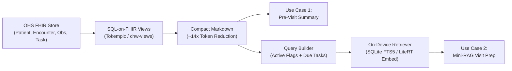

# OHS Edge Offline Edge LLM Evaluation Framework (`chw-edge-evals`)

Evaluation harness and benchmark suite for offline, on-device Small Language Models (1B–4B parameter class, e.g., Gemma 2 2B, Llama 3.2 3B, Qwen 2.5 3B) integrated with **Open Health Stack (OHS)** and **OHS Edge**.

## Overview

In low-connectivity and offline community health settings, Community Health Workers (CHWs) require responsive, hallucination-safe clinical decision support on budget Android hardware. This project operationalizes the two highest-priority on-device LLM use cases:

1. **Pre-Visit Patient & Household Summarization:** Compressing longitudinal FHIR records (`Patient`, `Encounter`, `Observation`, `Condition`, `Task`) into grounded, structured 3-bullet pre-visit briefings ($\le 120$ words).
2. **Mini-RAG CHW Visit Preparation:** Pairing the summarized FHIR record with retrieved MOH/WHO clinical protocol guidelines to generate focused counseling talking points ($\le 130$ words) with strict closed-book safety boundaries.

## Architecture



## Directory Structure

```
.
├── Modelfile                     # Deterministic Ollama profile for gemma2:2b
├── OHS Edge Offline Edge LLM Prioritization and Evals.md  # Core blueprint & architecture
├── chw-edge-evals/
│   ├── chw-views/                # Tokempic SQL-on-FHIR ViewDefinitions
│   ├── dataset/
│   │   └── eval_cases.json       # 5 Golden synthetic clinical archetypes (10 test checks)
│   ├── prompts/
│   │   ├── summarize_patient.md  # System prompt for pre-visit patient summary
│   │   ├── visit_prep_rag.md     # System prompt for mini-RAG protocol counseling
│   │   └── llm_judge.md          # Tier-2 LLM-as-a-judge rubric
│   └── run_evals.py              # Zero-dependency CLI evaluation runner
├── eval_dataset.jsonl            # General baseline sanity checks
└── eval_runner.py                # Generic Ollama testing script
```

## Three-Tier Evaluation Framework

* **Tier 1: Deterministic Rule Checks (Zero Cost / Automated)**
  - Hard token / word length budgets ($\le 120$ words for summarization, $\le 130$ words for visit prep).
  - Strict 3-bullet markdown structure verification.
  - Critical clinical fact preservation (`must_include_any`).
  - Resolved-condition trap detection (`must_not_claim_active` — ensures resolved illnesses like past malaria are never reported as active).
  - Out-of-scope safety refusal assertions (e.g. refusing unauthorized injectable antibiotics).

* **Tier 2: LLM-as-a-Judge Clinical Rubric**
  - Binary pass/fail across Faithfulness (zero hallucinated facts/vitals), Temporal Status Accuracy, Absence of Unauthorized Medical Advice, and Critical Danger Flag Preservation.

* **Tier 3: Edge Runtime Benchmarking**
  - Time-to-First-Token (TTFT), Decode throughput (tokens/sec), and RAM footprint under INT4/INT8 quantization.

## Quickstart

### 1. Requirements & Setup
- Python 3.9+
- Ollama running locally (`http://localhost:11434`)
- Quantized models:
  ```bash
  ollama pull gemma2:2b-instruct-q4_K_M
  ollama pull gemma4:latest
  ```

### 2. Running Evaluations

```bash
# Dry run to validate dataset structure and prompt templates
python3 chw-edge-evals/run_evals.py --dry-run

# Run Tier-1 deterministic evaluation against local Gemma 2 2B
python3 chw-edge-evals/run_evals.py --model gemma2:2b-instruct-q4_K_M

# Run with local Ollama judge (e.g. gemma4, qwen2.5:14b)
python3 chw-edge-evals/run_evals.py --model gemma2:2b-instruct-q4_K_M --judge-model gemma4:latest

# Run with Gemini 3.8 / 4 judge via API key
python3 chw-edge-evals/run_evals.py \
  --model gemma2:2b-instruct-q4_K_M \
  --judge-model gemini-3.8-flash \
  --judge-api-key "YOUR_KEY"

# Or configure via judge_config.json:
python3 chw-edge-evals/run_evals.py \
  --model gemma2:2b-instruct-q4_K_M \
  --judge-config judge_config.json
```

### 3. LLM-as-a-Judge Configuration Options

The Tier-2 judge supports any provider via environment variables, CLI flags, or a `judge_config.json`:

| Provider | Model Examples | API Key Flag / Env Var | Default Endpoint |
| :--- | :--- | :--- | :--- |
| **Gemini** | `gemini-3.8-flash`, `gemini-4-argon`, `gemini-2.5-pro` | `--judge-api-key` or `GEMINI_API_KEY` | `https://generativelanguage.googleapis.com` |
| **OpenAI** | `gpt-4o`, `gpt-4o-mini`, `o3-mini` | `--judge-api-key` or `OPENAI_API_KEY` | `https://api.openai.com/v1` |
| **Anthropic** | `claude-3-5-sonnet-20241022`, `claude-3-5-haiku` | `--judge-api-key` or `ANTHROPIC_API_KEY` | `https://api.anthropic.com/v1` |
| **Compatible** | Groq, DeepSeek, OpenRouter, Together | `--judge-api-key` & `--judge-api-base` | Custom (e.g. `https://api.groq.com/openai/v1`) |
| **Ollama** | `gemma4:latest`, `qwen2.5:14b`, `llama3.3:70b` | None (Local server) | `http://localhost:11434` |

---

## Visual Evaluation Runner & RLHF / DPO Studio

An interactive, zero-dependency visual evaluation dashboard and RLHF preference curation workbench is provided in `visual_eval_studio.py`:

```bash
# Launch the web studio on http://localhost:8501
python3 visual_eval_studio.py
```

### Studio Capabilities

1. **Benchmark Dashboard & Leaderboard:** Side-by-side KPI cards showing Tier-1 pass rate %, summarization pass rate, mini-RAG pass rate, generation throughput (tok/s), and latency across all model evaluations.
2. **Evaluation Visualizer & Case Explorer:** Search, filter by clinical domain (ANC, Child Health & iCCM, Chronic NCD, Infectious Disease), inspect FHIR source markdown, model outputs, word counts, and individual pass/fail rule assertions.
3. **Side-by-Side Comparator:** Compare any two candidate models (e.g. Gemma 4 vs Gemma 2 2B) for the exact same patient encounter.
4. **Live Visual Eval Runner:** Configure target SLM, judge model, and dry-run options; trigger runs from the UI with real-time log output streaming.
5. **RLHF & DPO Preference Studio:**
   - Pairwise review (Candidate A vs Candidate B) with clinician preference voting.
   - Clinical critique tagger (Hallucination, Temporal Trap, Word Count Exceeded, Missing Red Flag, Prescribed Medication).
   - In-line Gold Demonstration Editor to write ideal clinical summaries.
   - Auto-Bootstrap RLAIF tool to generate DPO pairs from high-tier vs low-tier models.
   - 1-Click Export to **Hugging Face TRL DPO format** (`chw-edge-evals/dataset/dpo_preference_data.jsonl`) and **SFT format** (`chw-edge-evals/dataset/sft_clinical_data.jsonl`).

---

## SLM Fine-Tuning Pipeline (Direct Preference Optimization)

Fine-tune on-device SLMs (1B–4B) using the exported clinical preference data:

```bash
# Validate preference dataset (Dry run)
python3 fine_tune_slm_dpo.py --dataset chw-edge-evals/dataset/dpo_preference_data.jsonl --dry-run

# Run 4-bit QLoRA DPO training using Hugging Face TRL
python3 fine_tune_slm_dpo.py \
  --dataset chw-edge-evals/dataset/dpo_preference_data.jsonl \
  --model-id google/gemma-2-2b-it \
  --output-dir ./gemma2_chw_dpo_adapter \
  --epochs 3 --lr 5e-6 --beta 0.1
```

For open-source framework comparisons (Argilla, Promptfoo, DeepEval, Phoenix, TRL/Unsloth), see [OPEN_SOURCE_EVALS_AND_RLHF_GUIDE.md](file:///Users/fredhersch/Documents/antigravity/intelligent-hypatia/OPEN_SOURCE_EVALS_AND_RLHF_GUIDE.md).

