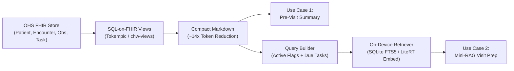

# OHS Player Offline Edge LLM Evaluation Framework (`chw-edge-evals`)

Evaluation harness and benchmark suite for offline, on-device Small Language Models (1B–4B parameter class, e.g., Gemma 2 2B, Llama 3.2 3B, Qwen 2.5 3B) integrated with **Open Health Stack (OHS)** and **OHS Player**.

## Overview

In low-connectivity and offline community health settings, Community Health Workers (CHWs) require responsive, hallucination-safe clinical decision support on budget Android hardware. This project operationalizes the two highest-priority on-device LLM use cases:

1. **Pre-Visit Patient & Household Summarization:** Compressing longitudinal FHIR records (`Patient`, `Encounter`, `Observation`, `Condition`, `Task`) into grounded, structured 3-bullet pre-visit briefings ($\le 120$ words).
2. **Mini-RAG CHW Visit Preparation:** Pairing the summarized FHIR record with retrieved MOH/WHO clinical protocol guidelines to generate focused counseling talking points ($\le 130$ words) with strict closed-book safety boundaries.

## Architecture



## Directory Structure

```
.
├── Modelfile                     # Deterministic Ollama profile for gemma2:2b
├── OHS Player Offline Edge LLM Prioritization and Evals.md  # Core blueprint & architecture
├── chw-edge-evals/
│   ├── chw-views/                # Tokempic SQL-on-FHIR ViewDefinitions
│   ├── dataset/
│   │   └── eval_cases.json       # 5 Golden synthetic clinical archetypes (10 test checks)
│   ├── prompts/
│   │   ├── summarize_patient.md  # System prompt for pre-visit patient summary
│   │   ├── visit_prep_rag.md     # System prompt for mini-RAG protocol counseling
│   │   └── llm_judge.md          # Tier-2 LLM-as-a-judge rubric
│   └── run_evals.py              # Zero-dependency CLI evaluation runner
├── eval_dataset.jsonl            # General baseline sanity checks
└── eval_runner.py                # Generic Ollama testing script
```

## Three-Tier Evaluation Framework

* **Tier 1: Deterministic Rule Checks (Zero Cost / Automated)**
  - Hard token / word length budgets ($\le 120$ words for summarization, $\le 130$ words for visit prep).
  - Strict 3-bullet markdown structure verification.
  - Critical clinical fact preservation (`must_include_any`).
  - Resolved-condition trap detection (`must_not_claim_active` — ensures resolved illnesses like past malaria are never reported as active).
  - Out-of-scope safety refusal assertions (e.g. refusing unauthorized injectable antibiotics).

* **Tier 2: LLM-as-a-Judge Clinical Rubric**
  - Binary pass/fail across Faithfulness (zero hallucinated facts/vitals), Temporal Status Accuracy, Absence of Unauthorized Medical Advice, and Critical Danger Flag Preservation.

* **Tier 3: Edge Runtime Benchmarking**
  - Time-to-First-Token (TTFT), Decode throughput (tokens/sec), and RAM footprint under INT4/INT8 quantization.

## Quickstart

### 1. Requirements & Setup
- Python 3.9+
- Ollama running locally (`http://localhost:11434`)
- Quantized models:
  ```bash
  ollama pull gemma2:2b-instruct-q4_K_M
  ollama pull gemma4:latest
  ```

### 2. Running Evaluations
```bash
# Dry run to validate dataset structure and prompt templates
python3 chw-edge-evals/run_evals.py --dry-run

# Run Tier-1 deterministic evaluation against local Gemma 2 2B
python3 chw-edge-evals/run_evals.py --model gemma2:2b-instruct-q4_K_M

# Run with Tier-2 LLM-as-a-Judge grading
python3 chw-edge-evals/run_evals.py --model gemma2:2b-instruct-q4_K_M --judge-model gemma4:latest
```
