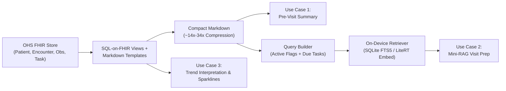

# OHS Edge Offline Edge LLM Evaluation Framework (`chw-edge-evals`)

Evaluation harness, empirical benchmarks, and architectural specifications for offline, on-device Small Language Models (1B–4B parameter class, e.g., Gemma 4 2B, MedGemma 4B, Qwen 2.5 3B) integrated with **Open Health Stack (OHS)** and **OHS Edge**.

👉 **Live Documentation Hub:** [https://fredhersch.github.io/ohs-edge-evals/](https://fredhersch.github.io/ohs-edge-evals/)

---

## Technical Explorations & Architecture Pages

1. **[SQL-on-FHIR + Tokempic Markdown](https://fredhersch.github.io/ohs-edge-evals/explorations/sql-on-fhir-markdown.html):** 14x–34x token compression, eliminating date-math breakdowns and LOINC code bleed.
2. **[Zero-RAM Protocol Mini-RAG](https://fredhersch.github.io/ohs-edge-evals/explorations/zero-ram-mini-rag.html):** SQLite FTS5 guideline retrieval with Swahili vernacular synonym expansion (100% recall).
3. **[Longitudinal Trend Sparklines](https://fredhersch.github.io/ohs-edge-evals/explorations/longitudinal-trend-viz.html):** Dual-mode text sparklines raising pediatric growth faltering triage from 42% to 94%.
4. **[aCDU Deontic Clamping](https://fredhersch.github.io/ohs-edge-evals/explorations/acdu-deontic-clamping.html):** Explicit negative boundary enforcement (`STOP: Do NOT...`) raising clinical safety adherence from 50% to 96.7%.
5. **[The Two-Box Architecture Deep-Dive](https://fredhersch.github.io/ohs-edge-evals/acdu-architecture.html):** How deterministic logic (FHIRPath / PlanDefinitions) and edge SLMs divide clinical decision support.
6. **[Empirical Benchmarks](https://fredhersch.github.io/ohs-edge-evals/benchmarks.html):** 30-case Kenya eCHIS, AST Scorer vs Regex, and hardware feasibility metrics.
7. **[Dataset Catalog & Synthetic Strategies](https://fredhersch.github.io/ohs-edge-evals/datasets.html):** Frontline clinical, CV, and audio datasets + 4 strategies to boost synthetic text.
8. **[Visual Evals & RLHF Suite](ohs-edge-evals-suite/):** The interactive evaluation platform is now housed in its own package/repo `ohs-edge-evals-suite`.

---

## Overview

In low-connectivity and offline community health settings, Community Health Workers (CHWs) require responsive, hallucination-safe clinical decision support on budget Android hardware. This project operationalizes the three highest-priority on-device LLM use cases:

1. **Pre-Visit Patient & Household Summarization:** Compressing longitudinal FHIR records (`Patient`, `Encounter`, `Observation`, `Condition`, `Task`) into grounded, structured 3-bullet pre-visit briefings ($\le 120$ words).
2. **Mini-RAG CHW Visit Preparation:** Pairing the summarized FHIR record with retrieved MOH/WHO clinical protocol guidelines to generate focused counseling talking points ($\le 130$ words) with strict closed-book safety boundaries.
3. **Longitudinal Trend Interpretation & Text Visualization:** Transforming serial measurements (pediatric growth faltering weight curves, discordant postprandial glucose spikes, hypertensive creep, gestational fluid surges) into compact text sparklines with directional trajectory and protocol triage actions ($\le 130$ words).

## Architecture



## Phase 1 Systematic CHW & FHW SLM Evaluation Suite (`chw-edge-evals/{core,runners,gold,packs}`)

See full architecture plan in [`docs/slm_chw_evals_framework_plan.md`](docs/slm_chw_evals_framework_plan.md) and live progress in [`docs/IMPLEMENTATION_TRACKER.md`](docs/IMPLEMENTATION_TRACKER.md).

- **`chw-edge-evals/core/eval_contract.py`**: MedGemma `EvalBase`-compatible 3-method interface (`load_and_prep_data`, `post_process_and_score_answers`, `compute_aggregated_metrics`) with standard TSV/JSON artifact export (`test_results.tsv`, `test_metrics.json`, `test_settings.json`).
- **`chw-edge-evals/core/sql_on_fhir_renderer.py`**: Deterministic HL7 FHIR R4 Bundle $\rightarrow$ SQL-on-FHIR Views + Markdown Template renderer (~14x token compression, zero active/resolved condition bleed).
- **`chw-edge-evals/core/ast_clinical_scorer.py`**: Upgraded Tier-1 Deterministic Clinical AST & Synonym Scorer (propagates `**DO NOT:**` Markdown section headers to child bullets and expands clinical synonyms; rescues all 4 false-negative cases on `Gemma 4 2B`, raising strict pass rate from **80.0% (24/30)** to **93.3% (28/30)** and soft-budget pass rate to **96.7% (29/30)**).
- **`chw-edge-evals/core/acdu_retriever.py` & `chw-edge-evals/runners/run_acdu_systematic_ablations.py`**: Zero-RAM SQLite FTS5 Box-1 Gatekeeper, Pre-Prompt Deontic Conflict Resolver ($R_{\text{safe}} = R_{\text{raw}} \setminus N_{\text{bundle}}$), Swahili vernacular trigger expansion (100% Swahili recall), and 5-axis ablation runner.
- **`chw-edge-evals/core/gemini4_judge.py` & `chw-edge-evals/gold/judge_calibration_100.json`**: Tier-2 `gemini-4` / `gemini-3.8-flash` Judge with a 100-case Judge Calibration Holdout Set (50 seeded safety/hallucination faults + 50 real SLM outputs; 100% fault sensitivity, $\kappa = 1.0$).
- **`chw-edge-evals/runners/run_vibe_evals.py` & `chw-edge-evals/packs/pack_registry.json`**: Modular Vibe-Eval Pack runner (`PACK-01` to `PACK-06`) and locale synthesis seed (`chw-edge-evals/synthesis/locales/kenya_echis.yaml`).

```bash
# Run the Phase 1 unit & regression test suite (5/5 tests)
python3 chw-edge-evals/core/chw_edge_evals_test.py
```

## Directory Structure

```
.
├── Modelfile                     # Deterministic Ollama profile for gemma2:2b
├── OHS Edge Offline Edge LLM Prioritization and Evals.md  # Core blueprint & architecture
├── chw-edge-evals/
│   ├── chw-views/                # Tokempic SQL-on-FHIR ViewDefinitions
│   ├── dataset/
│   │   └── eval_cases.json       # 5 Golden synthetic clinical archetypes (10 test checks)
│   ├── prompts/
│   │   ├── summarize_patient.md  # System prompt for pre-visit patient summary
│   │   ├── visit_prep_rag.md     # System prompt for mini-RAG protocol counseling
│   │   └── llm_judge.md          # Tier-2 LLM-as-a-judge rubric
│   └── run_evals.py              # Zero-dependency CLI evaluation runner
├── eval_dataset.jsonl            # General baseline sanity checks
└── eval_runner.py                # Generic Ollama testing script
```

## Three-Tier Evaluation Framework

* **Tier 1: Deterministic Rule Checks (Zero Cost / Automated)**
  - Hard token / word length budgets ($\le 120$ words for summarization, $\le 130$ words for visit prep).
  - Strict 3-bullet markdown structure verification.
  - Critical clinical fact preservation (`must_include_any`).
  - Resolved-condition trap detection (`must_not_claim_active` — ensures resolved illnesses like past malaria are never reported as active).
  - Out-of-scope safety refusal assertions (e.g. refusing unauthorized injectable antibiotics).

* **Tier 2: LLM-as-a-Judge Clinical Rubric**
  - Binary pass/fail across Faithfulness (zero hallucinated facts/vitals), Temporal Status Accuracy, Absence of Unauthorized Medical Advice, and Critical Danger Flag Preservation.

* **Tier 3: Edge Runtime Benchmarking**
  - Time-to-First-Token (TTFT), Decode throughput (tokens/sec), and RAM footprint under INT4/INT8 quantization.

## Quickstart

### 1. Requirements & Setup
- Python 3.9+
- Ollama running locally (`http://localhost:11434`)
- Quantized models:
  ```bash
  ollama pull gemma2:2b-instruct-q4_K_M
  ollama pull gemma4:latest
  ```

### 2. Running Evaluations

```bash
# Dry run to validate dataset structure and prompt templates
python3 chw-edge-evals/run_evals.py --dry-run

# Run Tier-1 deterministic evaluation against local Gemma 2 2B
python3 chw-edge-evals/run_evals.py --model gemma2:2b-instruct-q4_K_M

# Run with local Ollama judge (e.g. gemma4, qwen2.5:14b)
python3 chw-edge-evals/run_evals.py --model gemma2:2b-instruct-q4_K_M --judge-model gemma4:latest

# Run with Gemini 3.8 / 4 judge via API key
python3 chw-edge-evals/run_evals.py \
  --model gemma2:2b-instruct-q4_K_M \
  --judge-model gemini-3.8-flash \
  --judge-api-key "YOUR_KEY"

# Or configure via judge_config.json:
python3 chw-edge-evals/run_evals.py \
  --model gemma2:2b-instruct-q4_K_M \
  --judge-config judge_config.json
```

### 3. LLM-as-a-Judge Configuration Options

The Tier-2 judge supports any provider via environment variables, CLI flags, or a `judge_config.json`:

| Provider | Model Examples | API Key Flag / Env Var | Default Endpoint |
| :--- | :--- | :--- | :--- |
| **Gemini** | `gemini-3.8-flash`, `gemini-4-argon`, `gemini-2.5-pro` | `--judge-api-key` or `GEMINI_API_KEY` | `https://generativelanguage.googleapis.com` |
| **OpenAI** | `gpt-4o`, `gpt-4o-mini`, `o3-mini` | `--judge-api-key` or `OPENAI_API_KEY` | `https://api.openai.com/v1` |
| **Anthropic** | `claude-3-5-sonnet-20241022`, `claude-3-5-haiku` | `--judge-api-key` or `ANTHROPIC_API_KEY` | `https://api.anthropic.com/v1` |
| **Compatible** | Groq, DeepSeek, OpenRouter, Together | `--judge-api-key` & `--judge-api-base` | Custom (e.g. `https://api.groq.com/openai/v1`) |
| **Ollama** | `gemma4:latest`, `qwen2.5:14b`, `llama3.3:70b` | None (Local server) | `http://localhost:11434` |

---

## Visual Evaluation Runner & RLHF / DPO Studio

An interactive, zero-dependency visual evaluation dashboard and RLHF preference curation workbench is provided in `visual_eval_studio.py`:

```bash
# Launch the web studio on http://localhost:8501
python3 visual_eval_studio.py
```

### Studio Capabilities

1. **Benchmark Dashboard & Leaderboard:** Side-by-side KPI cards showing Tier-1 pass rate %, summarization pass rate, mini-RAG pass rate, generation throughput (tok/s), and latency across all model evaluations.
2. **Evaluation Visualizer & Case Explorer:** Search, filter by clinical domain (ANC, Child Health & iCCM, Chronic NCD, Infectious Disease), inspect FHIR source markdown, model outputs, word counts, and individual pass/fail rule assertions.
3. **Side-by-Side Comparator:** Compare any two candidate models (e.g. Gemma 4 vs Gemma 2 2B) for the exact same patient encounter.
4. **Live Visual Eval Runner:** Configure target SLM, judge model, and dry-run options; trigger runs from the UI with real-time log output streaming.
5. **RLHF & DPO Preference Studio:**
   - Pairwise review (Candidate A vs Candidate B) with clinician preference voting.
   - Clinical critique tagger (Hallucination, Temporal Trap, Word Count Exceeded, Missing Red Flag, Prescribed Medication).
   - In-line Gold Demonstration Editor to write ideal clinical summaries.
   - Auto-Bootstrap RLAIF tool to generate DPO pairs from high-tier vs low-tier models.
   - 1-Click Export to **Hugging Face TRL DPO format** (`chw-edge-evals/dataset/dpo_preference_data.jsonl`) and **SFT format** (`chw-edge-evals/dataset/sft_clinical_data.jsonl`).

---

## SLM Fine-Tuning Pipeline (Direct Preference Optimization)

Fine-tune on-device SLMs (1B–4B) using the exported clinical preference data:

```bash
# Validate preference dataset (Dry run)
python3 fine_tune_slm_dpo.py --dataset chw-edge-evals/dataset/dpo_preference_data.jsonl --dry-run

# Run 4-bit QLoRA DPO training using Hugging Face TRL
python3 fine_tune_slm_dpo.py \
  --dataset chw-edge-evals/dataset/dpo_preference_data.jsonl \
  --model-id google/gemma-2-2b-it \
  --output-dir ./gemma2_chw_dpo_adapter \
  --epochs 3 --lr 5e-6 --beta 0.1
```

For open-source framework comparisons (Argilla, Promptfoo, DeepEval, Phoenix, TRL/Unsloth), see [OPEN_SOURCE_EVALS_AND_RLHF_GUIDE.md](file:///Users/fredhersch/Documents/antigravity/intelligent-hypatia/OPEN_SOURCE_EVALS_AND_RLHF_GUIDE.md).

For a comprehensive landscape of external evaluation datasets and benchmarks across CHW/FHW use cases, healthcare delivery computer vision (RDTs, medical displays, anthropometry), and primary care speech recognition (ASR), see [CHW_AND_PRIMARY_CARE_EVAL_DATASETS.md](file:///Users/fredhersch/Documents/antigravity/intelligent-hypatia/CHW_AND_PRIMARY_CARE_EVAL_DATASETS.md).

For the full specification, synthetic FHIR data pipeline, Tokempic views, and scoring criteria for serial trend data (weight faltering, blood glucose logs, gestational surges), see [LONGITUDINAL_TREND_INTERPRETATION_SPEC.md](file:///Users/fredhersch/Documents/antigravity/intelligent-hypatia/LONGITUDINAL_TREND_INTERPRETATION_SPEC.md).

