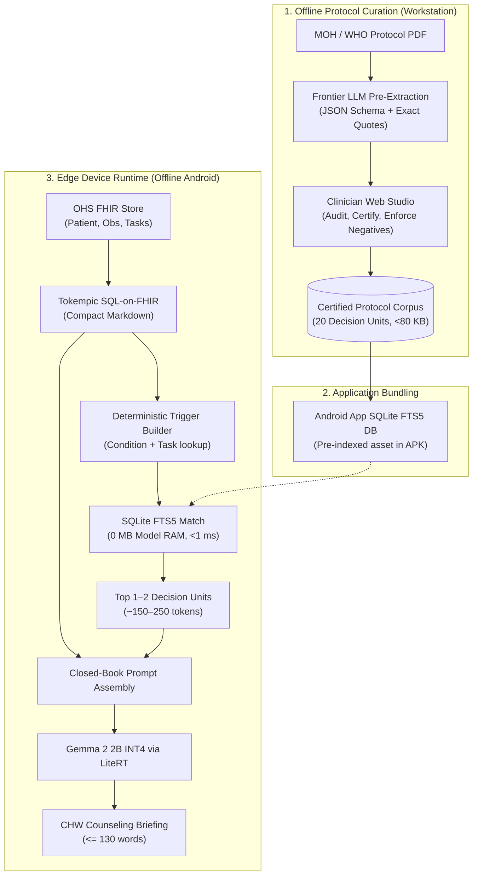

# OHS Edge Offline Mini-RAG Knowledge Base & Artifacts

> [!ABSTRACT] Executive Overview
> Complete product, engineering, and clinical specifications for the offline on-device **Mini-RAG & Protocol Grounding** capability within [[Open Health Stack]] ([[OHS Edge]]). Built for budget Android devices running Small Language Models (1B–4B class, e.g., Gemma 2 2B INT4 via [[LiteRT]]) for frontline [[Community Health Workers]] (CHWs / CHPs) adhering to Kenya [[Ministry of Health]] eCHIS and [[WHO SMART Guidelines]].

---

## Map of Content (MOC) & Document Index

| Note Title | Document Type | Scope & Summary |
| :--- | :--- | :--- |
| **[[Kenya eCHIS aCDU Journey and Strategic Roadmap]]** | **Journey & Deck Blueprint** | End-to-end retrospective from raw FHIR overload to aCDUs, 7 Kenya eCHIS modules, Gemma 4 2B empirical runs, and 10-slide deck blueprint. |
| **[[Gemma 4 2B Clinical Benchmark Assessment and Recommendations]]** | **Benchmark Audit** | Empirical analysis of Gemma 4 2B results, root cause analysis of 6 regressions, GBNF grammar constraints, and LoRA/DPO roadmap. |
| **[[Tokempic Edge Benchmark and Token Compression Analysis]]** | **Technical Analysis** | Empirical token compression analysis, 87.6% token reduction, and context window simulator metrics. |
| **[[Session_Synthesis_and_Research_Roadmap]]** | **Session Synthesis** | Complete chronological summary of everything built, empirical insights (Tokempic, a-CDUs, PHC multi-morbidity, Penda Health RCT analysis), and future research roadmap. |
| **[[Proposal Atomic Clinical Decision Units a-CDUs]]** | **Technical Proposal** | Academic & clinical proposal: formal definition of a-CDUs, lineage from Arden Syntax MLMs & WHO SMART DAKs, negative boundary clamping, and zero-RAM edge SQLite FTS5 retrieval. |
| **[[OHS Edge Mini-RAG PRD]]** | **PRD** | Product Requirements Document: user journeys, edge hardware constraints, deterministic CDS vs. generative narration boundary, and success metrics. |
| **[[Clinical Mini-RAG Pipeline Specification]]** | **Architecture Spec** | End-to-end RAG pipeline, Clinical Decision Unit (CDU) metadata schema, negative boundary prompt clamping, and web curation architecture. |
| **[[Clinical Protocol Metadata Extraction and Evals Specification]]** | **Evals & Alignment** | Frontier LLM extraction prompt, verbatim citation audit checklist, and 3-tier graduated test battery (Simple $\rightarrow$ Composite $\rightarrow$ Adversarial Traps). |
| **[[Kenya MOH Module 2 Clinical Protocols]]** | **Clinical Corpus** | Complete 20-chunk protocol dataset for Maternal & Newborn Health (MNH) covering ANC, Labor, PNC, and Essential Newborn Care. |
| **[[Open Source Edge Evals and RLHF Guide]]** | **Operational Guide** | Practical guide to running local SLM benchmarks, DPO alignment, and edge evaluation harnesses. |
| **[[OHS SLM Studio Spec and Continuous Alignment Roadmap]]** | **Architecture Spec** | Continuous alignment, DPO/ORPO training pipeline, and visual studio roadmap. |

---

## Core System Architecture

---

## Golden Architectural Rules

> [!IMPORTANT] Rule 1: The Two-Box Separation of Concerns
> **Code decides the clinical action; the SLM narrates the counseling briefing.**  
> The LLM must **never** perform clinical diagnosis, calculate drug doses, or decide triage urgency. Deterministic code ([FHIR engine] / [Tokempic] / eCHIS rules) determines the exact protocol key; the SLM translates that decision into an empathetic, plain-language 3-bullet briefing.

> [!DANGER] Rule 2: Mandatory Co-Location of Negative Boundaries
> To prevent edge models from hallucinating unauthorized medical treatments, every Clinical Decision Unit **must** co-locate explicit prohibitions (e.g., *"Strictly forbidden: do not administer injectable antibiotics at home"*) directly inside the prompt injection chunk.

> [!TIP] Rule 3: Zero-Model-RAM Edge Retrieval
> For small, bounded national protocols (50–140 chunks total), avoid loading heavy neural embedding models on 3GB RAM devices. Use **SQLite FTS5 (BM25)** for sub-millisecond, deterministic lookup with 0 MB extra model RAM.
