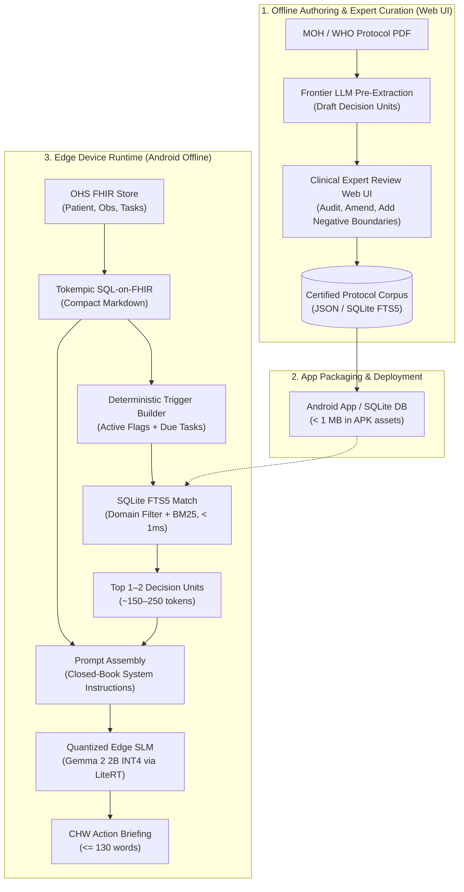

# Clinical Mini-RAG Pipeline Specification & Protocol Curation Guide

> [!ABSTRACT] Executive Summary
> Technical specification for the deterministic Mini-RAG pipeline running offline on budget Android devices within [[Open Health Stack]] ([[OHS Edge]]). Covers the schema for Clinical Decision Units (CDUs), negative boundary prompt clamping, deterministic lookup tables over [[SQLite]] FTS5, and the human-in-the-loop web curation interface.

## Document Index & Relations
- **Master Index:** [[00_Index_OHS_Edge_Mini_RAG]]
- **Product Requirements:** [[OHS Edge Mini-RAG PRD]]
- **Evals & Alignment Spec:** [[Clinical Protocol Metadata Extraction and Evals Specification]]
- **Clinical Protocol Corpus:** [[Kenya MOH Module 2 Clinical Protocols]]
- **Foundational Architecture:** [[OHS Edge Offline Edge LLM Prioritization and Evals]]

---

## 1. End-to-End Pipeline Architecture



---

## 2. Clinical Decision Unit (CDU) Metadata Schema

To make retrieval and generation **hallucination-proof**, every protocol unit is tagged with explicit semantic metadata and negative guardrails.

### JSON Schema Definition

```json
{
  "id": "KENYA-MOH-MNH-02",
  "domain": "02_mnh",
  "topic": "Hypertension & Suspected Pre-Eclampsia",
  "source_reference": {
    "organization": "Kenya Ministry of Health",
    "manual": "CHP Technical Training Manual - Module 2: Maternal and Newborn Health",
    "section": "Managing Danger Signs in Pregnancy",
    "page_or_code": "MoH 514 / eCHIS ANC-04"
  },
  "target_cohort": {
    "gender": "female",
    "min_gestation_weeks": 20,
    "patient_status": "pregnant"
  },
  "trigger_index": {
    "primary_conditions": ["hypertension", "pregnancy-induced hypertension", "pre-eclampsia", "high bp"],
    "symptoms": ["headache", "blurred vision", "epigastric pain", "face swelling"],
    "observations": ["bp >= 140/90", "proteinuria >= 1+"]
  },
  "clinical_payload": {
    "entry_criteria": "Gestational age >= 20 weeks with Systolic BP >= 140 mmHg OR Diastolic BP >= 90 mmHg.",
    "danger_signs": [
      "Severe frontal headache not relieved by ordinary analgesics",
      "Visual disturbances (blurring, flashes, double vision)",
      "Upper abdominal / epigastric pain or nausea",
      "Swelling of hands/face and sudden weight gain"
    ],
    "mandated_chw_actions": [
      "Initiate immediate emergency referral to nearest Level 4 hospital / CEmoNC facility",
      "Assist household with emergency transport and financial logistics",
      "Reassure mother; position comfortably on her left side during transit"
    ],
    "negative_boundaries": [
      "STRICTLY FORBIDDEN: Do not prescribe or administer oral or injectable antihypertensives at home (no labetalol, nifedipine, or hydralazine)",
      "STRICTLY FORBIDDEN: Do not attempt parenteral magnesium sulfate injection",
      "Prohibit home herbal teas, sedatives, or traditional remedies"
    ]
  },
  "prompt_injection_chunk": "### [PROTOCOL: KENYA-MOH-MNH-02] Pre-Eclampsia\nCRITERIA: GA >= 20w, BP >= 140/90 mmHg or proteinuria >= 1+.\nDANGER SIGNS: Severe frontal headache, vision blur, epigastric pain.\nMANDATED ACTIONS: Refer IMMEDIATELY to Level 4 Hospital. Arrange transport. Keep on left side.\nSTRICTLY FORBIDDEN: Do NOT administer antihypertensives or sedatives. Do NOT give injectable Magnesium Sulfate at community level."
}
```

---

## 3. The Clinical Boundary: Non-Generative Decision Support

> [!DANGER] Regulatory & Safety Principle: Non-Generative CDS
> **The LLM must never be used to diagnose or decide clinical triage.**

| Layer | Component | Function | Regulatory Class |
| :--- | :--- | :--- | :--- |
| **Decision Layer** | [[Kotlin FHIR Engine]] / [[Tokempic]] | Evaluates vitals (`BP >= 140/90`), flags danger signs, and triggers protocol `KENYA-MOH-MNH-02`. | Deterministic CDS (Standard eCHIS logic) |
| **Language Layer** | Edge SLM ([[Gemma]] 2 2B INT4) | Formats pre-selected protocol into a 3-bullet talking point ($\le 130$ words) for the CHW. | Administrative & Communication Aid |

---

## 4. Web Interface Options for Clinical Curation

### Option A: Built-in Protocol Studio in `visual_eval_studio.py` (Implemented)
- **Zero New Dependencies:** Native Python HTTP server (`http://localhost:8501`).
- **Split-Screen UX:** Protocol unit browser on left; rich clinical editor on right.
- **Negative Boundary Alert Box:** Highlights prohibitions in high-visibility red container.
- **Live Token Budget Meter:** Real-time token estimator ensuring chunks stay $\le 180$ tokens.
- **Deterministic Trigger Matcher:** Lets clinicians test simulated queries against the unit.

### Option B: Argilla Server (Multi-Clinician Teams)
- **Multi-user Workflow:** For distributed teams with multiple medical officers.
- **Hugging Face Integration:** Direct sync to Hugging Face datasets and TRL via `argilla_integration.py`.
- **Reference:** [[OPEN_SOURCE_EVALS_AND_RLHF_GUIDE]]
