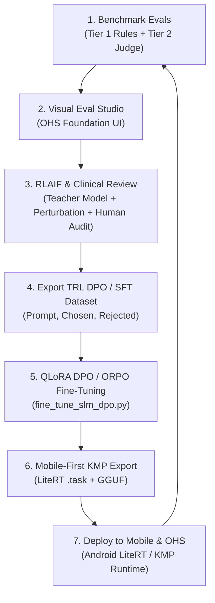
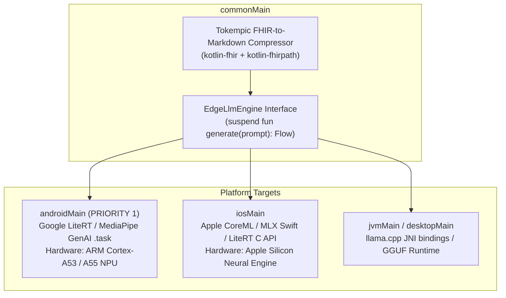
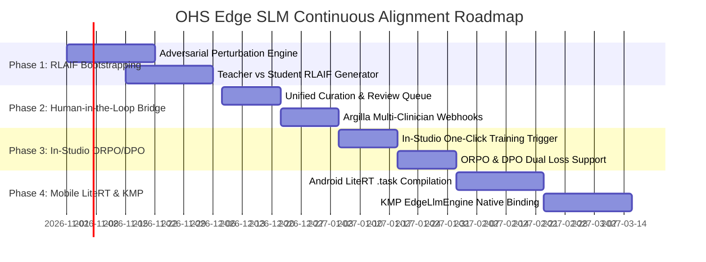

# OHS Edge SLM Studio: Product Specification & Continuous Alignment Roadmap

**Product:** OHS Edge SLM Studio  
**Target Platform:** Open Health Stack (OHS) & Offline Edge SLMs (1B–4B Class)  
**Brand Identity:** Open Health Stack Software Foundation (`ohs.foundation`)  
**Version:** 1.1.0  
**Date:** October 2026  

---

## 1. Executive Summary & Vision

### 1.1 The Challenge: Offline Edge Clinical Decision Support
In low-connectivity primary healthcare settings, Community Health Workers (CHWs) and frontline clinicians using budget mobile devices (Android 2GB–4GB RAM) require responsive, hallucination-safe clinical decision support for **relevant offline use-cases (starting with CHW workflows)**:
1. **Pre-Visit Patient & Household Summarization:** Compressing longitudinal FHIR bundles (`Patient`, `Encounter`, `Observation`, `Condition`, `Task`) via Tokempic Markdown into structured 3-bullet briefings ($\le 120$ words).
2. **Mini-RAG CHW Visit Preparation:** Grounding retrieved MOH/WHO clinical guidelines and patient flags into focused counseling points ($\le 130$ words) with strict closed-book refusal boundaries.

### 1.2 The Failure Modes of 1B–4B Edge Models
Quantized Small Language Models (SLMs) such as Gemma 2 2B, Llama 3.2 3B, and Qwen 2.5 3B routinely fail in three critical dimensions:
- **Length & Budget Drift:** Exceeding mobile viewport limits (> 120 words), resulting in text truncation on budget phones.
- **Temporal & Status Traps:** Reporting resolved past medical events (e.g., past malaria) as current active conditions.
- **Safety Boundary Breaches:** Providing out-of-scope clinical advice or prescribing restricted medications (e.g., parenteral antibiotics) instead of instructing an urgent referral.

### 1.3 The Solution: OHS Edge SLM Studio
The **OHS Edge SLM Studio** unifies evaluation, clinical safety grading, human-in-the-loop preference collection (RLHF), and Direct Preference Optimization (DPO / ORPO) into a single, closed-loop developer and clinical workbench.



---

## 2. System Architecture & Design System

### 2.1 Backend Architecture
- **Zero-Dependency Runtime:** Built purely on Python 3.9+ standard library (`http.server`, `socketserver`, `subprocess`, `threading`, `json`, `urllib`).
- **Asynchronous Execution Engine:** Manages background benchmark subprocesses (`run_evals.py`) in non-blocking threads with rolling telemetry buffer capture (up to 2,000 log lines).
- **Resilient Socket Binding:** Implements active port conflict detection with automated failover (scans from port 8501 to 8520) to eliminate `Errno 48 Address already in use` runtime halts.

### 2.2 Frontend Architecture & Design System
The user interface is built strictly adhering to the **Open Health Stack Software Foundation (`ohs.foundation`) Design System**:
- **Design Tokens (OKLCH with Hex Fallbacks):**
  - Canvas: `--bg: #f8faf9`
  - Secondary Canvas: `--bg-2: #f1f5f3`
  - Surface: `--surface: #ffffff`
  - Ink (Primary Text): `--ink: #1c2830`
  - Soft Ink: `--ink-soft: #4e5f6a`
  - Border Lines: `--line: #e1e8eb`
  - AI Commons (Violet): `--ai: #7a4db8` with `--ai-wash: #f3effa`
  - FHIR-Native Core (Blue): `--core: #1f75a8` with `--core-wash: #edf5fb`
  - OHS Toolkit (Teal): `--toolkit: #1e7e8b` with `--toolkit-wash: #ecf6f7`
  - Clinical Pass: `--green: #1ca564` with `--green-wash: #edf8f2`
  - Clinical Fail: `--rose: #dc3e42` with `--rose-wash: #fdf1f1`
- **Typography:**
  - Primary UI Sans: **`Hanken Grotesk`** (Google Fonts)
  - Code & Telemetry: **`IBM Plex Mono`**
- **Brand Mark:**
  - 4-rounded-square OHS Foundation brand stack (`.logo-mark i`) representing Teal, Core, AI, and Deep Teal.

---

## 3. Algorithm Deep-Dive: DPO vs. ORPO vs. KTO for Edge SLMs

To drive higher performance on small 1B–4B models with limited VRAM, selecting the right preference alignment algorithm is critical.

| Dimension | Direct Preference Optimization (DPO) | Odds Ratio Preference Optimization (ORPO) | Kahneman-Tversky Optimization (KTO) |
| :--- | :--- | :--- | :--- |
| **How it Works** | Replaces RL reward model by optimizing policy directly against a frozen reference model copy: $\mathcal{L}_{\text{DPO}}(\pi_\theta; \pi_{\text{ref}})$ | Combines supervised instruction loss with an odds-ratio penalty between chosen and rejected completions: $\mathcal{L}_{\text{ORPO}} = \mathcal{L}_{\text{SFT}} + \lambda \mathcal{L}_{\text{OR}}$ | Optimizes against binary feedback (thumbs up / thumbs down) using prospect theory value functions without paired rankings |
| **Reference Model** | **Required** ($\pi_{\text{ref}}$ must stay in memory or re-computed via adapter toggling) | **None** (Zero reference model overhead) | **Required** (Needs reference model) |
| **Memory Footprint (VRAM)** | ~1.5–2× base model size (two forward passes per step) | **1× base model size** (cuts VRAM by ~40–50%) | ~1.5–2× base model size |
| **Training Steps** | 2-step: SFT warm-up first, then DPO | **1-step:** Single monolithic training run combining SFT + preference | 1-step after SFT |
| **Edge SLM Suitability** | Excellent if base checkpoint is already strongly instruction-tuned (e.g. Gemma 2 2B Instruct) | **Exceptional for Edge SLMs** (prevents catastrophic format degradation and fits on 8GB VRAM / Mac MPS) | Good if only un-paired binary clinician ratings are available |
| **Key Limitation** | Sensitive to temperature $\beta$; can degrade if chosen/rejected drift far from reference | Slightly less published clinical domain benchmarking than DPO | Lower sample efficiency; sensitive to imbalance between positive and negative labels |

### Recommendation for OHS Edge Models
- **Default Recommendation: ORPO.** Because 1B–4B models are prone to "format collapse" when trained with DPO alone, ORPO simultaneously anchors the model to the clinical instruction structure (SFT loss) while penalizing clinical traps (odds-ratio penalty) with **zero reference-model VRAM penalty**.
- **Architecture Support:** The fine-tuning script supports both via `--algorithm orpo` and `--algorithm dpo`.

---

## 4. Mobile-First & Kotlin Multiplatform (KMP) Architecture

The Open Health Stack Foundation relies heavily on **Kotlin Multiplatform (KMP)** for shared FHIR data models, business logic, and cross-platform UI. The SLM deployment pipeline reflects this hierarchy: **mobile-first prioritization with a unified KMP abstraction layer**.



### 4.1 KMP Multiplatform Engine Interface
```kotlin
package org.ohs.engine.ai

import kotlinx.coroutines.flow.Flow

interface EdgeLlmEngine {
    /** Generate streaming tokens from compact Tokempic FHIR prompt */
    suspend fun generateStream(prompt: String, maxTokens: Int = 256): Flow<String>

    /** Single-shot synthesis with timeout */
    suspend fun generate(prompt: String, maxTokens: Int = 256): Result<String>

    /** Telemetry: Time-to-First-Token, decode speed, peak RAM */
    fun getTelemetry(): LlmTelemetry
}
```

### 4.2 Mobile-First Quantization & Compilation Targets
1. **Android (Target 1 - LiteRT / MediaPipe):**
   - Merged LoRA weights are converted to `.task` flatbuffers via Google's `ai-edge-torch` or LiteRT GenAI Converter.
   - Quantization: 4-bit AWQ / XNNPACK optimized for budget MediaTek / Qualcomm Snapdragon chipsets.
2. **KMP JVM & Developer Testing (Target 2 - GGUF):**
   - Merged weights are converted to GGUF (`q4_K_M`, `q8_0`) for instant testing via Ollama, desktop JVM, and developer workstations.

---

## 5. Phased Continuous Improvement Roadmap



### Phase 1: RLAIF & Adversarial Perturbation Bootstrapping (Immediate)
*Initial condition: No dedicated pool of clinicians available.*
- **Teacher Model Supervision:** Use high-tier models (Gemma 4, Gemini 3.8 Flash) to generate gold baseline completions.
- **Automated Perturbation (Negative Pair Synthesis):** Generate 500+ contrastive negative pairs by programmatically mutating gold summaries:
  1. *Temporal Traps:* Mutate resolved conditions (`Malaria | resolved | 2025-11-10`) into active conditions (`Active malaria fever`).
  2. *Length Violations:* Pad outputs to 160+ words with generic advice to train strict word adherence.
  3. *Safety Boundary Breaches:* Inject unauthorized prescriptions (e.g., adding "Give 500mg Amoxicillin orally") into visit preparation prompts that require hospital referral.
- **Automated Constitutional Critic:** Leverage Gemini 3.8 Flash to evaluate and score completions against Tier-1/Tier-2 rubrics automatically.

### Phase 2: Seamless Human-in-the-Loop Bridge (Month 2)
*Condition: Transition smoothly as clinical partners and CHW supervisors join.*
- **Unified Curation Schema:** Add `source: "rlaif_synthetic" | "clinician_verified"` to every preference pair.
- **Clinician Audit Queue:** Clinicians do not need to create pairs from scratch; they review pre-generated RLAIF pairs in the Studio or Argilla, approving, rejecting, or refining gold text with 1 click.
- **Inter-Annotator Agreement:** Compute Fleiss' Kappa across multi-clinician ratings to identify ambiguous clinical guideline interpretations.

### Phase 3: In-Studio DPO & ORPO Training (Month 3)
- **One-Click Training from Studio:** Trigger training directly from Tab 5 of the Web Studio with real-time loss tracking.
- **Dual Algorithm Support:** Support both ORPO (`--algorithm orpo`, recommended) and DPO (`--algorithm dpo`).
- **Quantization Degradation Benchmarks:** Automatically evaluate the aligned model across FP16, INT8, and INT4 (Q4_K_M) quantizations to detect if 4-bit weight pruning re-introduces hallucinations.

### Phase 4: Mobile LiteRT & KMP Android Integration (Month 4)
- **LiteRT `.task` Packaging:** Automated script converting fine-tuned adapters to Google LiteRT GenAI flatbuffers.
- **KMP `EdgeLlmEngine` Implementation:** Native bindings in `androidMain` tested on physical budget Android hardware (ARM Cortex-A53/A55) measuring live TTFT, RAM usage, and battery consumption.
- **Automated CI/CD Quality Gate:** Pull request blocker in GitHub Actions ensuring no model or prompt checkpoint can be committed if Tier-1 pass rate drops below 95%.
