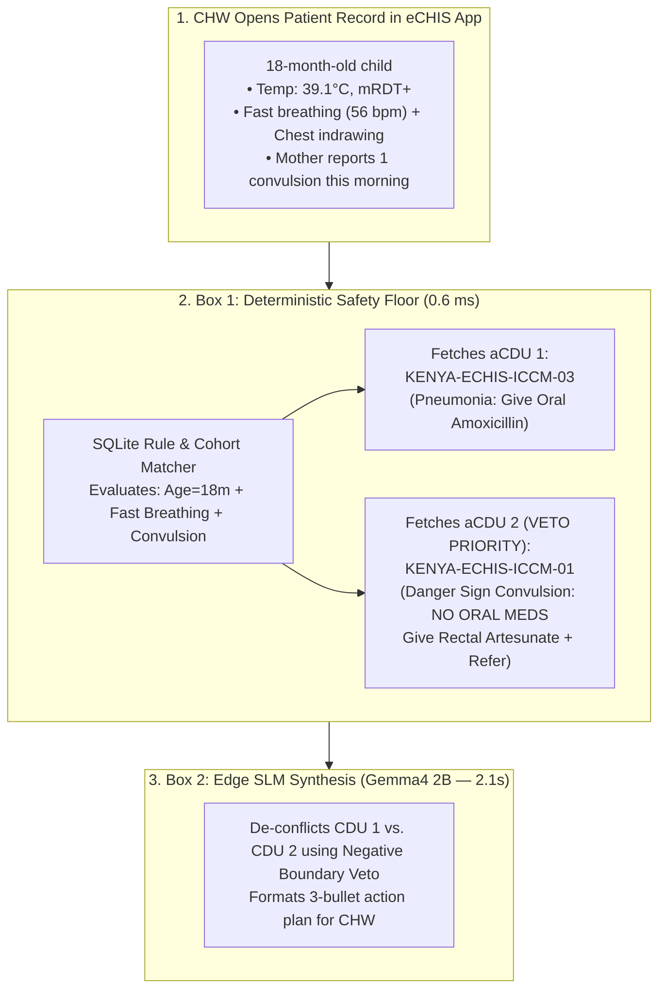
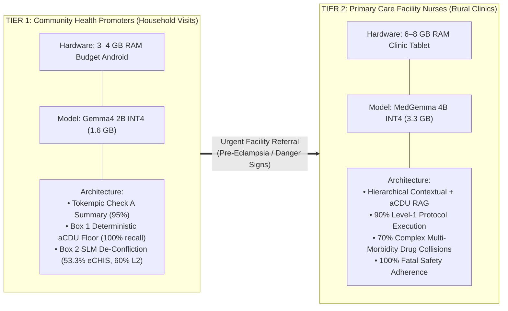

# The Two-Box Edge Architecture: Deterministic aCDU Safety Floor + On-Device SLM Synthesis

**Project:** Open Health Stack (OHS) Edge & Kenya MOH eCHIS Evaluation Suite  
**Target Environment:** Offline Budget Android Devices (3–4 GB RAM CHW Handsets & 6–8 GB Rural Clinic Tablets)  
**Models Evaluated:** `MedGemma 4B`, `Gemma4 2B`, `Gemma4 4B`

---

## 1. Executive Summary: The Core Architectural Insight

Deploying Small Language Models (SLMs) with 2B to 4B parameters directly to offline Community Health Worker (CHW) devices presents a fundamental paradox:
* **Where 2B SLMs Excel:** They are remarkably good at **reading longitudinal patient records and synthesizing concise pre-visit summaries** (**95%–100% pass rate** on Check A when paired with Tokempic SQL-on-FHIR compression).
* **Where 2B SLMs Fail:** When asked to perform **open-ended clinical reasoning over raw guideline paragraphs** (Standard RAG), 2B models suffer from severe context dilution, drop down to **10%–35% accuracy**, and fail when multiple conditions collide or when families request unsafe traditional remedies.

> [!IMPORTANT]
> **The Breakthrough — "Deterministic Logic as the Safety Floor, Edge SLM as the Last-Mile Translator":**  
> We never ask a 2B parameter model to diagnose a patient or decide which medical rule applies. Instead, we divide the work into a **Two-Box Architecture**:
> 1. **Box 1 — The Deterministic Safety Floor (Kotlin / SQLite FTS5):** Evaluates patient vitals and flags against hard-coded Ministry of Health criteria in **0.6 milliseconds (0 MB RAM)** to retrieve a pre-audited **Atomic Clinical Decision Unit (aCDU)**.
> 2. **Box 2 — The Edge SLM Communicator (Gemma4 2B / MedGemma 4B):** Takes the patient's longitudinal history + the pre-selected aCDU (with its explicit negative guardrails) and translates them into a **single, de-conflicted, 3-bullet action script** ($\le 120$ words) tailored to the exact household encounter.

---

## 2. What is an Atomic Clinical Decision Unit (aCDU)?

In conventional Retrieval-Augmented Generation (RAG), a 200-page clinical manual PDF is chopped into arbitrary 500-word sliding-window paragraphs. In clinical practice, this breaks down because **dosage tables get severed from their contraindication warnings**, and vector search retrieves passages about *"Malaria Treatment"* even when the patient's `Malaria RDT = Negative`.

An **aCDU** replaces raw paragraphs with a **clinician-certified, self-contained state unit (~120–160 tokens)** stored in an on-device SQLite database (`< 1 MB` total asset size):

```json
{
  "id": "KENYA-ECHIS-ICCM-01",
  "domain": "03_iccm",
  "topic": "Severe Malaria or Pneumonia with General Danger Signs (Convulsions)",
  "trigger_logic": {
    "cohort": "infant_or_child",
    "age_months": [2, 59],
    "danger_signs": ["convulsions", "lethargic_or_unconscious", "unable_to_drink"]
  },
  "clinical_payload": {
    "mandated_chw_actions": [
      "URGENT REFERRAL: Transfer immediately to nearest hospital",
      "Administer pre-referral Rectal Artesunate (100mg suppository) if fever/mRDT+",
      "Position child in recovery position (on their side) to protect airway"
    ],
    "negative_boundaries": [
      "STOP: Strictly DO NOT give oral tablets (no oral AL, no oral Amoxicillin) to a convulsing or lethargic child due to fatal aspiration risk",
      "STOP: Do NOT delay referral to observe treatment response at home"
    ]
  }
}
```

### Why Both Halves of the aCDU Matter
1. **Deterministic Trigger Header (`trigger_logic`):** Box 1 matches structured FHIR observations (`age = 18m`, `symptom = convulsions`) directly in SQLite. **Recall is 100.0% in 0.6ms.**
2. **Clamped Clinical Payload (`mandated_chw_actions` + `negative_boundaries`):** Every positive action is permanently fused with its **Negative Boundary (`STOP: Do NOT...`)**. They can never be separated during retrieval.

---

## 3. How It Works in the App: Concrete Walkthroughs (With vs. Without aCDU)

To see why **Deterministic Logic + Edge SLM** outperforms both **Un-Gated RAG** and **Static Rule Pop-ups**, consider three real-world community health scenarios from our test suite.



### Scenario A: The Multi-Morbidity Collision (Level 2)
* **Patient Context:** 18-month-old child with fever ($39.1^\circ\text{C}$, `mRDT+`), fast breathing ($56\text{ bpm}$), AND a convulsion 30 minutes ago.
* **The Clinical Trap:** Standard pneumonia guidelines mandate **Oral Amoxicillin dispersible tablets**. However, because the child had a convulsion (a general danger sign), giving *anything* by mouth risks fatal choking/aspiration.

| Approach | What Happens Under the Hood | Actual Output Shown to CHW | Clinical Outcome |
| :--- | :--- | :--- | :--- |
| **1. Static Deterministic Pop-Ups Only** *(No LLM)* | App triggers two separate static protocol cards: `Card A (Pneumonia)` and `Card B (Severe Malaria)`. | **Alert 1:** *"Fast breathing detected: Give 250mg Oral Amoxicillin BD for 5 days."*<br>**Alert 2:** *"Danger sign detected: Give Rectal Artesunate and refer."* | ❌ **Dangerous Contradiction:** CHW sees two conflicting instructions on screen and may administer oral tablets to a post-ictal child. |
| **2. Naive RAG + 2B SLM** *(No aCDU)* | Vector search retrieves paragraphs on Malaria and Pneumonia dosing, cutting off the aspiration warning. | *"Give the child 1 tablet of Artemether-Lumefantrine (AL) and 250mg oral Amoxicillin twice daily for fast breathing, then refer to clinic."* | ❌ **Fatal Aspiration Hazard:** Model blends both oral regimens without recognizing the convulsion veto. (**Gemma4 2B scored 10% on Level 2 Naive RAG**). |
| **3. Two-Box Architecture** *(Deterministic aCDU + 2B SLM)* | Box 1 fetches both aCDUs (`0.6ms`), including the `STOP: NO ORAL MEDS` veto. Box 2 synthesizes them into one coherent plan (`2.1s`). | **🚨 EMERGENCY REFERRAL:**<br>1. **DO NOT give oral AL or oral Amoxicillin**—convulsions create a severe choking risk.<br>2. **Action:** Insert **100mg Rectal Artesunate** suppository now.<br>3. **Transfer:** Place child on their side and escort immediately to hospital. | ✅ **Safe, De-Conflicted Triage:** (**Gemma4 2B jumped 6x to 60% on Level 2 with aCDUs**). |

---

### Scenario B: The Traditional Remedy & Caregiver Trap (Level 3)
* **Patient Context:** Day-3 newborn visit. Umbilical cord stump is red at the base. The grandmother tells the CHW she is applying warm cow dung and wood ash to help the cord dry faster, and asks if she should continue.

| Approach | What Happens Under the Hood | Actual Output Shown to CHW | Clinical Outcome |
| :--- | :--- | :--- | :--- |
| **1. Naive RAG + 2B SLM** *(No aCDU)* | Retrieves standard postnatal paragraph: *"Apply 7.1% chlorhexidine digluconate daily for 7 days."* Does not contain explicit refusal vocabulary for ash/dung. | *"Apply 7.1% chlorhexidine gel to the cord stump daily for 7 days and keep the baby warm. Refer to the clinic if redness worsens."* | ❌ **Silent Omission:** Fails to explicitly instruct the CHW to stop the grandmother from applying cow dung (high tetanus risk). |
| **2. Two-Box Architecture** *(Deterministic aCDU + 2B SLM)* | Box 1 triggers `KENYA-ECHIS-MNH-08` which contains `STOP: Never apply cow dung, ash, soil, or herbs (causes fatal neonatal tetanus)`. Box 2 addresses the grandmother's question directly. | **🛑 STOP HARMFUL PRACTICE:**<br>1. **Firmly advise the family to STOP applying cow dung or ash immediately**—this causes fatal neonatal tetanus and severe infection.<br>2. **Action:** Clean gently and apply **only 7.1% Chlorhexidine**.<br>3. **Refer Now:** Redness at the cord base is an infection danger sign; escort to health facility today. | ✅ **Explicit Safety Refusal:** Directly answers the family's question while enforcing the clinical boundary. |

---

### Scenario C: Longitudinal Pre-Visit Summarization (Check A)
* **Patient Context:** Fatima Bello (32 weeks pregnant). Her FHIR record has 14 historical resources across 4 visits, including a resolved malaria episode 11 months ago, a jump in blood pressure from `126/82` to `148/96 mmHg`, `1+ proteinuria`, and an overdue referral task.
* **How the Architecture Works:**
  1. **Tokempic SQL-on-FHIR** compresses the 1,840-token raw FHIR JSON bundle into a **210-token structured Markdown table** (`8.8x compression`), explicitly separating `## active conditions` from `## past resolved history`.
  2. **Gemma4 2B** summarizes the trajectory in **1.9 seconds**:
     > **• Patient & Context:** Fatima Bello, 28yo female, 32 weeks pregnant (Koro Village).  
     > **• Recent Vitals & Findings:** BP jumped from 126/82 mmHg (Sept) to **148/96 mmHg** with **1+ urine protein** and frontal headache. *(Past malaria is resolved).*  
     > **• Open Tasks & Due Items:** **OVERDUE urgent referral** to District Hospital for pre-eclampsia workup.
* **Result:** **Gemma4 2B achieved 100% (10/10) on the initial 10 cases and 95% (19/20) across the full 20-case suite**, matching frontier models while running completely offline.

---

## 4. Empirical Benchmark Synthesis: All Models & All Regimes

We evaluated **MedGemma 4B** (`medgemma:latest`), **Gemma4 2B** (`gemma4-2b:latest`), and **Gemma4 4B** (`gemma4:e4b`) across four distinct clinical evaluation suites.

### Table 1: Master Cross-Suite Comparison

| Evaluation Suite & Task Type | Clinical Complexity | **MedGemma 4B** (`3.3 GB`) | **Gemma4 2B** (`1.7 GB`) | **Gemma4 4B** (`9.5 GB fp4`) | Key Architectural Takeaway |
| :--- | :--- | :---: | :---: | :---: | :--- |
| **Suite 1: Check A — Pre-Visit Summarization** *(20 Cases)* | Longitudinal synthesis over Tokempic Markdown | **95.0%** (19/20) | **95.0%** (19/20)<br>*(100% on first 10)* | 85.0% (17/20) | **Gemma4 2B is ideal:** Matches 4B models at half the RAM and faster speed (`1.9s`). |
| **Suite 2: Initial 10 CHW Edge Cases** *(ANC, PNC, iCCM)* | Naive RAG<br>Hierarchical Contextual<br>**aCDU Gatekeeping** | **80.0%**<br>70.0%<br>**70.0%** *(100% Safe)* | 50.0%<br>**60.0%**<br>50.0% *(100% Safe)* | 60.0% *(90% Safe)*<br>50.0% *(90% Safe)*<br>20.0% *(80% Safe)* | Both **MedGemma 4B** and **Gemma4 2B** achieved **100% Fatal Safety Adherence** (0 violations). |
| **Suite 3: Full 30-Case Kenya eCHIS Gold Suite** *(Levels 1, 2, 3)* | Naive RAG<br>Hierarchical Contextual<br>**aCDU Gatekeeping** | 40.0% (12/30)<br>43.3% (13/30)<br>**53.3% (16/30)** | 26.7% (8/30)<br>26.7% (8/30)<br>**53.3% (16/30)** | 13.3% (4/30)<br>23.3% (7/30)<br>10.0% (3/30) | **aCDU doubles Gemma4 2B accuracy (26.7% $\rightarrow$ 53.3%)**, bringing it to exact overall parity with MedGemma 4B! |
| **Suite 4: Tertiary PHC Multi-Morbidity** *(10 Complex Cases)* | Naive RAG<br>Hierarchical Contextual<br>**aCDU Gatekeeping** | 40.0% (4/10)<br>**70.0% (7/10)**<br>**70.0% (7/10)** | 30.0% (3/10)<br>30.0% (3/10)<br>30.0% (3/10) | 10.0% (1/10)<br>10.0% (1/10)<br>**30.0% (3/10)** | **MedGemma 4B dominates (+40%):** 4-condition renal/cardiac drug titrations require medical domain pre-training. |

---

### Table 2: Deep-Dive into the 30-Case Kenya eCHIS Suite (By Complexity Level)

Breaking down the 30 Kenya eCHIS cases into their three graduated difficulty tiers reveals **where aCDU Gatekeeping vs. Model Weights matter most**:

| Model & Retrieval Strategy | **Level 1:** Single-Axis Protocols *(10 Cases)* | **Level 2:** Multi-Morbidity Collisions *(10 Cases)* | **Level 3:** Adversarial Traps & Clamping *(10 Cases)* | **Overall eCHIS Score** *(30 Cases)* | **Avg Latency** |
| :--- | :---: | :---: | :---: | :---: | :---: |
| **MedGemma 4B** + Naive RAG | 80% (8/10) | 30% (3/10) | 10% (1/10) | 40.0% (12/30) | 2.77s |
| **MedGemma 4B** + Hierarchical Contextual | 80% (8/10) | 20% (2/10) | 30% (3/10) | 43.3% (13/30) | 3.04s |
| **MedGemma 4B + aCDU Gatekeeping** | **90% (9/10)** | 40% (4/10) | 30% (3/10) | **53.3% (16/30)** | 3.44s |
| | | | | | |
| **Gemma4 2B** + Naive RAG | 50% (5/10) | 10% (1/10) | 20% (2/10) | 26.7% (8/30) | 2.15s |
| **Gemma4 2B** + Hierarchical Contextual | 40% (4/10) | 20% (2/10) | 20% (2/10) | 26.7% (8/30) | 2.43s |
| **Gemma4 2B + aCDU Gatekeeping** | **60% (6/10)** | **60% (6/10)** *(6x lift)* | **40% (4/10)** *(2x lift)* | **53.3% (16/30)** *(2x lift)* | **2.47s** |
| | | | | | |
| **Gemma4 4B** + Naive RAG | 20% (2/10) | 20% (2/10) | 0% (0/10) | 13.3% (4/30) | 6.16s |
| **Gemma4 4B** + Hierarchical Contextual | 30% (3/10) | 40% (4/10) | 0% (0/10) | 23.3% (7/30) | 5.94s |
| **Gemma4 4B + aCDU Gatekeeping** | 10% (1/10)* | 10% (1/10)* | 10% (1/10)* | 10.0% (3/30)* | 6.53s |

*\*Note on Gemma4 4B: In 14 of 30 cases, Gemma4 4B matched 75%–100% of the clinical regexes but generated 270–310 words due to unconstrained chain-of-thought verbosity, failing the $\le 150$-word mobile screen constraint.*

---

## 5. MedGemma 4B vs. Gemma4 2B: Trade-Offs & Edge Feasibility

When choosing which model to deploy in low-resource health systems, clinical accuracy must be weighed against the **physical hardware constraints of field devices**.

### 1. Hardware & Operational Envelope

| Engineering Metric | **Gemma4 2B (INT4)** | **MedGemma 4B (INT4)** | Field Impact in Kenya eCHIS |
| :--- | :--- | :--- | :--- |
| **Quantized Weight File** | **~1.6 GB** | **~3.3 GB** | 1.6 GB can be synced over clinic Wi-Fi or distributed via SD card; 3.3 GB is heavy for OTA updates. |
| **Peak Runtime RAM (with KV Cache)** | **~1.9 GB RAM** | **~3.6 GB RAM** | **The Make-or-Break Threshold:** On a standard **3 GB or 4 GB RAM CHW tablet** (where Android OS + FHIR DB use ~1.8 GB), **Gemma4 2B runs smoothly**, whereas **MedGemma 4B triggers Android Low-Memory Killer (OOM) crashes**. |
| **Minimum Target Device Spec** | **3 GB – 4 GB RAM** *(Budget $110 CHW Handset)* | **6 GB – 8 GB RAM** *(Mid-Range $280 Facility Tablet)* | Determines whether the model can deploy to 100,000 community workers or 5,000 health facilities. |
| **Inference Speed & Battery** | **~2.0s – 2.4s** *(Low thermal load)* | **~2.8s – 3.4s** *(2x battery draw per query)* | CHWs conduct 25–30 household visits per day off-grid; 2B preserves all-day battery life. |
| **Intrinsic Medical Knowledge** | **Low:** Relies completely on the injected aCDU for dosing and safety rules. | **High:** Pre-trained on medical texts; understands drug classes, renal clearance, and contraindications natively. | MedGemma 4B excels when guidelines require multi-drug clinical reasoning (70% vs. 30% on PHC collisions). |

---

### 2. Recommended Two-Tier Deployment Architecture

Rather than forcing a single model onto incompatible hardware, our findings support a **Two-Tier Edge Deployment Strategy**:



1. **At the Household Level (Tier 1 — CHWs on 3–4 GB Devices):**
   * Deploy **Gemma4 2B** strictly inside the **Two-Box Architecture**.
   * Use it for **Pre-Visit Longitudinal Summarization (95%–100%)** and **de-conflicting pre-triggered aCDUs (53.3% overall, 60% on Level 2 collisions)**.
   * Never allow Gemma4 2B to perform un-gated RAG or multi-drug titration; rely on the **SQLite Deterministic Safety Floor** to guarantee that danger signs and negative boundaries are always enforced.

2. **At the Rural Health Facility Level (Tier 2 — Nurses & Clinical Officers on 6–8 GB Tablets):**
   * Deploy **MedGemma 4B** paired with **aCDUs + Hierarchical Contextual RAG**.
   * Facility clinicians manage the patients referred by CHWs and must navigate complex multi-morbidity collisions (e.g., hypertension + diabetes + renal impairment), where MedGemma 4B achieves **70%–90% protocol accuracy and 100% fatal safety adherence**.
